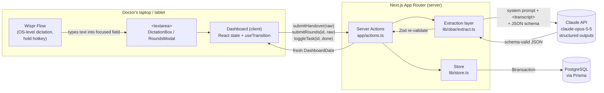
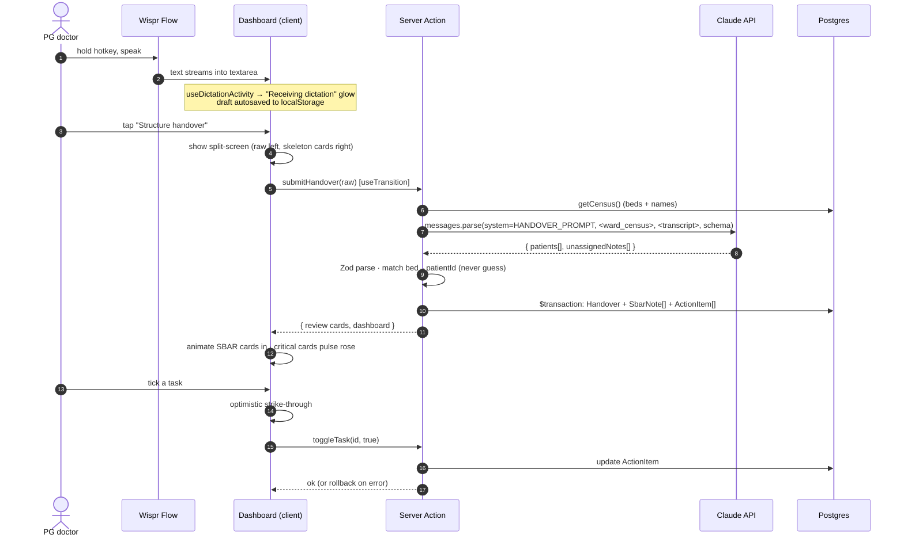
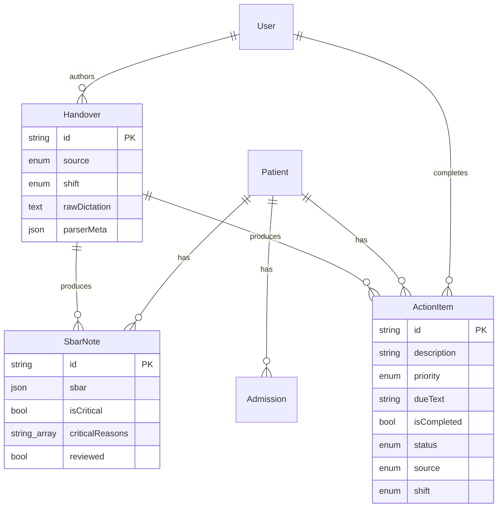

# Pulse Flow: System Architecture (HLD + LLD)

## 1. High-level design



**Key decisions**

| Concern | Decision | Why |
|---|---|---|
| Voice capture | Wispr Flow at the OS level types into a plain `<textarea>` | No mic permissions, no audio upload and no STT stack to run. The browser only ever sees text. |
| API surface | Next.js **Server Actions** (no REST layer) | Typed end-to-end, one hop, and `revalidatePath` keeps the RSC cache honest. |
| LLM output | Claude **structured outputs** (`output_config.format` from a Zod schema) + Zod re-parse | The model can't return malformed JSON, and we still validate before any DB write. |
| Safety | Prompt forbids invented data. Raw transcript stored immutably. Split-screen review. | The AI produces a draft and the doctor stays responsible for the record. |
| Persistence | Postgres + Prisma, one `$transaction` per dictation | A handover is written completely or not at all. |
| Demo mode | No `DATABASE_URL` → in-memory ward | A hackathon demo runs with only an API key. |

## 2. Request lifecycle (sequence)



**Live rounds** follows the same path with `submitRounds(patientId, raw)`. The server first loads the patient's **existing care plan** (latest SBAR + open action items with IDs) and sends it to the model as `<existing_care_plan>`. The model returns `updatedSbar`, `newActionItems`, `cancelActionItemIds` and `completeActionItemIds`. The server **drops any ID that wasn't in the plan it sent**, so the model can only touch that patient's open items.

## 3. Low-level design

### 3.1 Module map

```
app/
  page.tsx            RSC: getDashboard() → <Dashboard initial/>
  actions.ts          "use server": submitHandover · submitRounds · toggleTask
  layout.tsx, globals.css
components/
  Dashboard.tsx       state owner: data, draft, review, modal, transitions
  DictationBox.tsx    shift brain dump input + VoiceIndicator
  LiveReview.tsx      split screen: raw transcript | parsed SBAR cards
  PatientCard.tsx     ward grid tile (rose pulse if critical, emerald if stable)
  RoundsModal.tsx     Framer Motion shared-layout modal for bedside dictation
  ActionBoard.tsx     kanban: STAT / High / Routine / Done, grouped by bed
  TaskSidebar.tsx     sticky ward-wide checklist
  TaskRow.tsx, SbarBlock.tsx, VoiceIndicator.tsx, useDictationActivity.ts
lib/
  sbar/schema.ts      Zod contracts (LLM ⇄ app)
  sbar/system-prompt.ts  Deliverable 4: versioned prompts
  sbar/extract.ts     Claude calls, refusal/max_tokens handling, ID whitelisting
  store.ts            Prisma or in-memory persistence
  db.ts, types.ts, demo-data.ts
prisma/schema.prisma, seed.ts
```

### 3.2 Server Action contracts

```ts
submitHandover(raw: string)
  → { ok: true, data: { review: ReviewCard[], unassigned: string[], dashboard: DashboardData } }
  | { ok: false, error: string }

submitRounds(patientId: string, raw: string)
  → { ok: true, data: { uncertainties: string[], dashboard: DashboardData } } | { ok: false, error }

toggleTask(id: string, done: boolean) → { ok: true, data: null } | { ok: false, error }
```

Errors come back as values, not thrown exceptions, so the client never loses the dictation text.

### 3.3 LLM call

```ts
client.messages.parse({
  model: "claude-opus-5-5",
  max_tokens: 16000,
  system: HANDOVER_SYSTEM_PROMPT,           // or ROUNDS_SYSTEM_PROMPT
  output_config: { effort: "medium", format: zodOutputFormat(HandoverExtractionSchema) },
  messages: [{ role: "user", content: "<ward_census>…</ward_census>\n<transcript>…</transcript>" }],
})
```

- `stop_reason === "refusal"` → user-facing error, nothing persisted
- `stop_reason === "max_tokens"` → asks the doctor to split the dictation
- The transcript is "fenced": any `<transcript>`-style tags inside it are stripped so dictated text can't fake sections of the prompt
- Every `Handover.parserMeta` stores `{ model, promptVersion }` for audit and replay

### 3.4 Patient matching rules

1. Normalise the bed ("Bed No. 14" → `14`) and match it exactly against the census.
2. Otherwise, match on name only if **exactly one** patient matches.
3. Otherwise it's **unmatched**: the card shows "Not saved" and nothing is written. The system never auto-creates a patient from speech.

### 3.5 Optimistic UI

| Interaction | Optimistic step | Reconcile |
|---|---|---|
| Tick a task | Flip `isCompleted` locally → animated strike-through | On `ok:false`, flip back |
| Structure handover | Open split screen immediately, raw text + skeleton cards | Replace with parsed cards + server `DashboardData` |
| Update care plan | Button → "Merging orders…", textarea locked | Replace dashboard. Uncertainties shown inline. |

After each mutation the server returns the full `DashboardData` (it's small: one ward). That avoids client-side merge bugs, and `revalidatePath("/")` keeps other tabs consistent on their next navigation.

### 3.6 Data model (summary)



## 4. Production hardening (post-hackathon)

- **Auth & RBAC**: NextAuth/Clerk with hospital SSO. `PG_DAY`/`PG_NIGHT`/`CONSULTANT` roles. Every write gets an author.
- **PHI**: encrypt `rawDictation` at rest, apply India's DPDP Act (and HIPAA if needed), host in-region, and sign a BAA/DPA with the LLM provider.
- **Realtime**: Postgres `LISTEN/NOTIFY` or Pusher/Ably so every tablet on the ward updates live.
- **Review gate**: require `SbarNote.reviewed = true` before the incoming shift sees the note as final.
- **Evals**: a golden set of anonymised dictations that checks hallucinated values (target 0), missed tasks and critical-flag recall.
