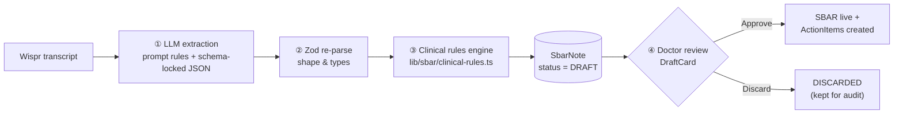

# Clinical validation & edge cases

Pulse Flow never trusts one layer. Each dictation passes through four gates before anything reaches the ward:



| Layer | Good at | Code |
|---|---|---|
| ① LLM | Understanding messy language and intent | [`system-prompt.ts`](../lib/sbar/system-prompt.ts) `<self_corrections>`, `<missing_information>`, `<contradictions>` |
| ② Zod | Shape guarantees | [`schema.ts`](../lib/sbar/schema.ts) |
| ③ Rules | Arithmetic: thresholds and the last value of each vital | [`clinical-rules.ts`](../lib/sbar/clinical-rules.ts) `validateDraft()` |
| ④ Human | Final clinical judgement | [`DraftCard.tsx`](../components/DraftCard.tsx), `approveDraft()` in [`store.ts`](../lib/store.ts) |

Run the tests (no API key needed): `npm run test:rules`. All 12 pass, including the exact vitals from [demo script 2](05-wispr-test-scripts.md#2-the-messy-edge-case).

---

## Edge case 1: mid-sentence correction

> *"Start IV fluids. No, wait, hold fluids. Start Lasix instead."*

**Risk:** the checklist ends up with both *Start IV fluids* and *Hold IV fluids*.

**Prompt rule (`<self_corrections>`):** the last stated intent wins. Retracted orders appear in no SBAR field and no task. Every correction is logged in a `corrections[]` array as `{ retracted, replacedWith, quote }`, which the schema now requires.

**Deterministic guard (`validateDraft` → `isRetracted`):**
```ts
for (const c of out.corrections) {
  const leaked = out.actionItems.filter((a) => isRetracted(a.description, c));
  out.actionItems = out.actionItems.filter((a) => !leaked.includes(a));   // strip it
  for (const a of leaked) pushOnce(out.uncertainties, `Removed “${a.description}”: you retracted it…`);
}
// The AI missed a correction entirely? Look for spoken markers and ask.
if (CORRECTION_MARKER.test(text) && out.corrections.length === 0)
  pushOnce(out.uncertainties, `Possible self-correction near “…sorry…”. Check the orders…`);
```
Corrected vitals are covered too: `readVitals("BP 90 over 60, sorry, 80 over 60")` → SBP **80**, because the last value wins.

**UI:** the lavender **"AI applied N self-corrections"** tile shows each one as a blush ~~retracted~~ → mint *final* pill pair, so the doctor sees exactly what the AI changed.

## Edge case 2: missing information

> *The doctor never mentions Background or Recommendation.*

**Prompt rule (`<missing_information>`):** an unstated section becomes `""`. The model never fills a gap or summarises the tasks into Recommendation.

**Code:** `missingFields = SBAR_KEYS.filter(k => !sbar[k].trim())`. This is stored on the note. Every renderer treats `""` as **Pending**, so a missing section can't crash anything. A completely empty extraction still returns a valid draft plus *"Please re-dictate."*

**UI:** the missing section renders as a dashed butter-yellow tile with a **Pending** pill and an open text area: *"Not dictated. Tap here and hold your Wispr key to add the background."* The doctor fills the gap by voice and approves. They can also approve as is, with a visible "2 sections pending" note. Either choice is recorded (`edited = true` if they filled it).

## Edge case 3: contradictory vitals

> *"Bed 9 is stable, BP 70/40, sleeping."*

**Prompt rule (`<contradictions>`):** numbers beat adjectives. Set `isCritical: true`, keep the doctor's word "stable" in Assessment unchanged, and add the contradiction to `uncertainties`.

**Deterministic guard:** `criticalFindings()` re-reads the doctor's own words for this patient (the transcript segment, not the AI's summary) using the same thresholds as the prompt:

| Vital | Critical when |
|---|---|
| BP | SBP < 90 (children: < 70 + 2×age) or MAP < 65 |
| HR / RR | > 120 or < 50 / > 24 or < 10 (adults only) |
| SpO2 | < 92 % |
| K⁺ / Na⁺ | ≥ 6.0 or ≤ 2.5 / ≤ 120 or ≥ 160 |
| Glucose · Hb · Lactate · GCS | < 60 · < 7 · > 4 · ≤ 12 |

```ts
if (out.findings.length && !out.isCritical) { out.isCritical = true; out.autoEscalated = true; }
if (STABLE_WORDS.test(sbar.assessment)) pushOnce(out.uncertainties,
  "Dictated as stable, but BP 70/40 (SBP < 90) meets critical criteria. Auto-escalated to critical. Please confirm.");
```

**Avoiding false alarms:**
- **Last value wins:** "K 6.1, repeat came back 4.8" is not critical, and neither is "BP 84/50, after fluids 112/70". Both are in the tests.
- **Paediatric guard:** "HR 150" in a 6-year-old isn't flagged by adult rules, and the draft says so.

**UI:** the card turns **blush** immediately (the patient card shows *Critical · unconfirmed*), even before approval, because a safety signal shouldn't wait for sign-off. The draft carries a **"Auto-escalated by vitals check"** pill. A doctor can downgrade it in Edit mode. The override is recorded (`edited = true`, `approvedById`).

---

## Other guardrails

| Risk | Guard |
|---|---|
| Wrong patient | Match on bed first, then on a **unique** first name. If it's ambiguous, nothing is saved and the card shows "No matching patient". |
| AI cancels a task on another patient | Rounds IDs are filtered to the open-item list we sent, and `updateMany` also filters by `patientId`. |
| Transcript tries to inject instructions | Tags are stripped from the transcript (`fence()`) and the prompt says the transcript is data only. |
| Two doctors approve the same draft | Conditional `updateMany({ where: { id, status: "DRAFT" } })` acts as an optimistic lock, so the second gets "already reviewed". |
| Junior signs off the consultant's orders | Rounds drafts need `role === CONSULTANT` (checked on the server). The button reads "Consultant sign-off". |
| Lost dictation | Draft is autosaved to `localStorage`. Every error path keeps the text in the box. |
| Audit | Raw transcript is immutable. Notes keep `corrections`, `uncertainties`, `autoEscalated`, `edited`, `approvedById`/`At`. Discarded drafts are kept. |

**Known limits:** numbers spoken as words ("seventy over forty") aren't parsed by the rules engine; the LLM still handles them. Thresholds are adult defaults, not a validated early-warning score such as NEWS2. Clinical sign-off is needed before real use.
