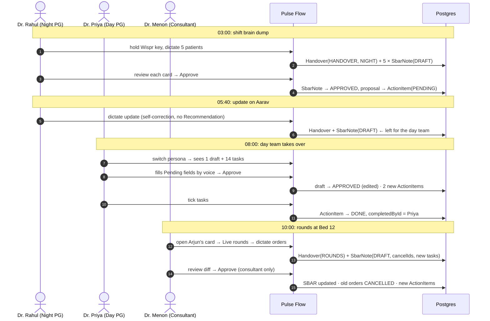

# The 24-hour journey

Three doctors, one ward, one device. Switch persona with the name pill in the top-right of the dashboard.

| Persona | Role | Moment |
|---|---|---|
| 🌙 **Dr. Rahul Verma** | Night PG | 03:00 brain dump |
| ☀️ **Dr. Priya Raghavan** | Day PG | 08:00 picks up the ward |
| 🩺 **Dr. Suresh Menon** | Consultant | 10:00 live rounds |

---

## ① 03:00: Dr. Rahul, the shift brain dump

**He does:** taps the lavender **Speak your handover** card, holds the Wispr key and talks for about 90 seconds. Then he taps **Structure handover**.

**The system does:**
1. `submitHandover(raw)` → Claude extracts per-patient SBAR, tasks and corrections.
2. Beds are matched against the census and `validateDraft()` runs on each patient. Vikram (ICU-2) is critical: BP 84/50, lactate 4.6.
3. The **Review & approve** split screen opens: raw transcript on the left, five DraftCards on the right.
4. Rahul checks each card and taps **Approve**.

**Database:**

| Table | Change |
|---|---|
| `Handover` | +1 `h-0300` · `source=HANDOVER` · `shift=NIGHT` · `authorId=u-rahul` · `rawDictation` (immutable) |
| `SbarNote` | +5 `status=DRAFT` → after approval `APPROVED`, `approvedById=u-rahul`. `n-a.isCritical=true`, `criticalReasons=[BP 84/50, HR 128, SpO2 90%, Lactate 4.6]` |
| `ActionItem` | +15 `PENDING`, created **only at approval** from each note's `proposal.actionItems` |

At **05:40** he dictates a quick update on Aarav. He corrects himself mid-sentence ("ibuprofen, sorry, tepid sponging and paracetamol") and gives no assessment or plan. That draft is **left for the day team** (`n-d-draft`, `DRAFT`, `missingFields=[assessment, recommendation]`, 1 correction).

> This is the state `npm run db:seed` creates.

## ② 08:00: Dr. Priya, picking up the ward

**She does:** switches persona to Priya. The sidebar's approvals badge shows **1**. The ward overview shows 1 critical, 4 stable, 14 pending and 1 to approve.

1. **Awaiting approval:** she opens Aarav's draft and sees:
   - the lavender correction tile, ~~Gave ibuprofen~~ → *Tepid sponging and paracetamol*
   - butter uncertainties (platelet trend, paediatric thresholds)
   - two dashed **Pending** tiles
   She holds Wispr in the Assessment tile ("Dengue day 3, falling platelets, no warning signs") and in the Recommendation tile ("CBC at 2 PM, review if under 50,000"). Then she taps **Approve with edits**.
2. **Ward checklist:** she works down the list, STAT first ("Repeat ABG and lactate", ICU-2), tapping each round checkbox. Each row strikes through and shows **✓ Dr. Priya Raghavan**.

**Database:**

| Table | Change |
|---|---|
| `SbarNote` `n-d-draft` | `DRAFT → APPROVED` · `edited=true` · `missingFields=[]` · `approvedById=u-priya` |
| `ActionItem` | +2 from the draft proposal ("Recheck temperature", "Watch for dengue warning signs") |
| `ActionItem` (ticked) | `status=DONE` · `isCompleted=true` · `completedAt=now` · `completedById=u-priya` |

Patient D's card now shows the approved SBAR, and its "Awaiting approval" pill is gone.

## ③ 10:00: Dr. Menon, live rounds

**He does:** at Bed 12 (Arjun, POD 1), Priya taps the card's stethoscope and hands him the tablet, switched to Menon. He holds the Wispr key and fires off orders ([test script 3](05-wispr-test-scripts.md#3-the-consultant-rapid-fire)).

**The system does:**
1. `submitRounds(patientId, raw)` → Claude gets the **existing care plan** (approved SBAR plus open tasks with their IDs) and returns a merged plan.
2. The server keeps only task IDs that belong to Arjun's open items. `validateDraft()` runs with Arjun's age.
3. A DraftCard appears in the modal under **Your sign-off**, showing:
   - an updated SBAR
   - ⊕ new tasks in mint
   - ⊖ cancelled orders in blush ("Stop")
   - ✓ completions
4. Menon taps **Approve**. If Priya had tried, the button would read **Consultant sign-off** and be locked.

**Database:**

| Table | Change |
|---|---|
| `Handover` | +1 `source=ROUNDS` · `shift=DAY` · `authorId=u-menon` |
| `SbarNote` | +1 `DRAFT` → `APPROVED` by `u-menon`. Becomes Arjun's live SBAR (latest approved). |
| `ActionItem` | `cancelIds` → `CANCELLED` (e.g. *Continue IV ceftriaxone and metronidazole*). `completeIds` → `DONE`. New orders (pip-taz, CT abdomen, …) → `PENDING`, `source=ROUNDS`. |

The ward checklist and action board update immediately, and the new tasks are tagged *From rounds*.
