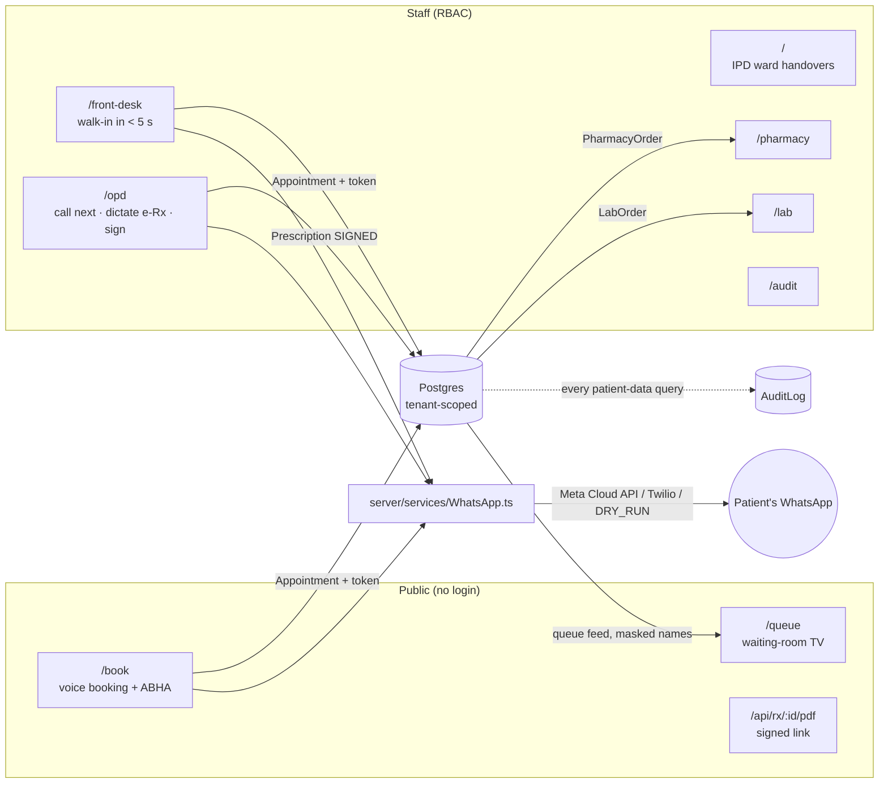

# Pulse Flow: platform architecture

From a ward-handover tool to a voice-first OS for mid-sized hospitals and clinics.

## Modules

| Route | Who | What | Key code |
|---|---|---|---|
| `/book?f=slug` | Patient | Mic → symptoms → department + date pre-filled → optional ABHA → token | `components/booking/*`, `lib/opd/intake.ts`, `lib/opd/red-flags.ts` |
| `/front-desk` | Receptionist | Wispr walk-in → one tap → token (stopwatch shows seconds). Check in online bookings, mark no-shows | `components/opd/FrontDesk.tsx`, `lib/opd/booking.ts` |
| `/opd` | Consultant / PG | Priority queue, **Call next**, patient card (ABHA, allergies), Rx dictation → editable draft → **Sign with HPR ID** | `components/opd/OpdConsole.tsx`, `RxEditor.tsx`, `lib/opd/rx.ts`, `rx-rules.ts`, `prescriptions.ts` |
| `/queue` | TV | Now serving per room, next 4, priority badges, spoken announcements, polls every 5 s | `components/opd/QueueBoard.tsx`, `app/api/queue` |
| `/pharmacy` | Pharmacist | Queued → Preparing → Ready → Dispensed, with Rx PDF and an allergy pill | `components/opd/Fulfillment.tsx`, `lib/fulfillment.ts` |
| `/lab` | Lab tech | Ordered → Sample → Processing → Reported, urgent tests first | same |
| `/audit` | Admin / DPDP officer | Access log filtered by action/patient, plus the WhatsApp outbox with payloads | `app/audit/page.tsx` |
| `/` | PGs / consultants | IPD handovers (previous work), now tenant-scoped | `components/Dashboard.tsx` |

## Voice → structured data

Provider: `lib/llm.ts` sends the same prompts and Zod schemas to **Gemini** (`interactions.create` with a JSON-schema `response_format`) or **Claude** (structured outputs), whichever `.env` selects. The model and provider are stored on every handover for audit.

| Input | Model call | Deterministic safety net |
|---|---|---|
| Patient symptoms | `parseIntake` (fast model: `GEMINI_FAST_MODEL`, or Claude at effort `low`): department from the facility's own list, date resolved in IST, urgency | `detectRedFlags` (15 rules). Either layer flags an emergency → 108 screen, and booking is refused server-side |
| Walk-in | same, `mode: frontdesk` | same, and the token jumps the queue |
| OPD Rx | `parsePrescription`: scribe-only prompt, Indian shorthand, corrections, labs split out | `validateRx`: frequency/duration parsing, quantity, missing fields, duplicates, **allergy class match** (penicillin ↔ Augmentin…), paediatric note. Re-run at signing |

## Multi-tenancy

- Every patient-data table has `facilityId`. `lib/db.ts` exports `db`, a Prisma client extension that **injects `facilityId` into every `where` and `data`** from an `AsyncLocalStorage` request context. A tenant table queried without a context **throws** (fail closed).
- The context is set by `withStaff(permission, purpose, fn)` (from the session) or `withPublic(facilityId, purpose, fn)` (from the URL slug).
- Raw SQL (the token counter) scopes explicitly with `requireCtx().facilityId`.
- **Demo:** switch persona to *Pooja Nair (Baner clinic)*. The front desk shows only the clinic's tokens, and the hospital's patients don't exist for her.

## RBAC (`lib/rbac.ts`)

| | Ward | Approve rounds | OPD consult | Sign Rx | Front desk | Pharmacy | Lab | Audit |
|---|---|---|---|---|---|---|---|---|
| Night / Day PG | ✓ | | ✓ (draft) | | | | | |
| Consultant | ✓ | ✓ | ✓ | ✓ + HPR ID | | read | read | |
| Receptionist | | | | | ✓ | | | |
| Pharmacist | | | | | | ✓ | | |
| Lab tech | | | | | | | ✓ | |
| Admin | | | | | ✓ | read | read | ✓ |

- **Enforced on the server** in every action and page. The UI also hides modules a role can't use.
- **Refusals are logged:** each one writes an `AuditLog` row with action `DENIED`.
- **Signing needs both:** `role === CONSULTANT` **and** an `hprId`. Signing stores the HPR ID snapshot plus a SHA-256 over the final content as a tamper-evident seal. This is not a CCA-licensed digital signature certificate (DSC); see Production gaps.

## DPDP Act 2023 audit trail

- **What gets logged:** the same extension writes one `AuditLog` row per read or write that touches patient data. Each row holds:
  - actor and role (or `PUBLIC`)
  - action
  - model and record id
  - `patientIds[]` (GIN-indexed)
  - **purpose**, taken from the context: "OPD consultation", "Front desk registration"…
- **Explicit events:** `SIGN`, `SEND` (WhatsApp), `EXPORT` (PDF), `LOGIN`, `DENIED`.
- **Consent:**
  - Booking requires an explicit care-processing consent (`careConsentAt`).
  - WhatsApp has its own opt-in (`whatsappConsent`). Without it the engine records `SKIPPED_NO_CONSENT` and doesn't send.
- **Minimisation:**
  - The waiting-room TV and public APIs mask names ("Ramesh K.").
  - The PDF link is HMAC-signed and expires after 7 days.
  - `MessageLog` stores payloads but never secrets.

## WhatsApp engine (`server/services/WhatsApp.ts`)

**Pipeline:** builders → `TemplateMessage` → `toMetaPayload` (Graph API `/{phone-number-id}/messages`, template + document header) or `toTwilioPayload` (`Messages.json`, `ContentSid` + `ContentVariables`) → `sendWhatsApp` (consent check, 10 s timeout, never throws, logs + audits).

**Templates:** `opd_token_v1`, `rx_document_v1` (PDF header), `followup_care_v1`. Their body text is in the file, ready to submit for Meta approval.

**Provider setting:** with no `WHATSAPP_PROVIDER` set, everything runs in **DRY_RUN**. Payloads are built and logged as `SIMULATED`.

## ABDM / ABHA (M1, simulated)

- **Flow:** `lib/abdm/abha-sandbox.ts` mirrors the M1 flow: mobile OTP (rate-limited, 3 attempts, 5-minute expiry, hashed) → verify → choose an existing ABHA on that mobile or create one → link to the facility's patient record.
- **Registry:** the national registry is a local `AbhaSandboxAccount` table. Numbers use a `99-` prefix and addresses end in `@sbx`.
- **OTP:** shown on screen and labelled **Sandbox**, never sent by SMS. No Aadhaar is collected.
- **Going live:** swap these four functions for ABDM gateway calls, after registering the facility (HFR) and obtaining sandbox client credentials. The UI and booking code stay the same.

## Production gaps (be honest in the pitch)

- Real authentication (SSO, plus HPR-verified login for doctors) in place of the persona cookie.
- Real ABDM integration: M1 gateway, then M2 (HIP care-context linking) and M3 (HIU consent).
- Prescription e-signing with a CCA-licensed DSC (e.g. eSign API) if the Rx must be legally signed digitally.
- Approved WhatsApp templates and a Business account. Inbound replies and webhooks aren't handled yet.
- A formulary with dose-range and interaction checking. Today only allergy classes are checked.
- Rate limiting backed by Redis, `LINK_SIGNING_SECRET` set in production, and audit-log retention plus export for data-principal requests.
