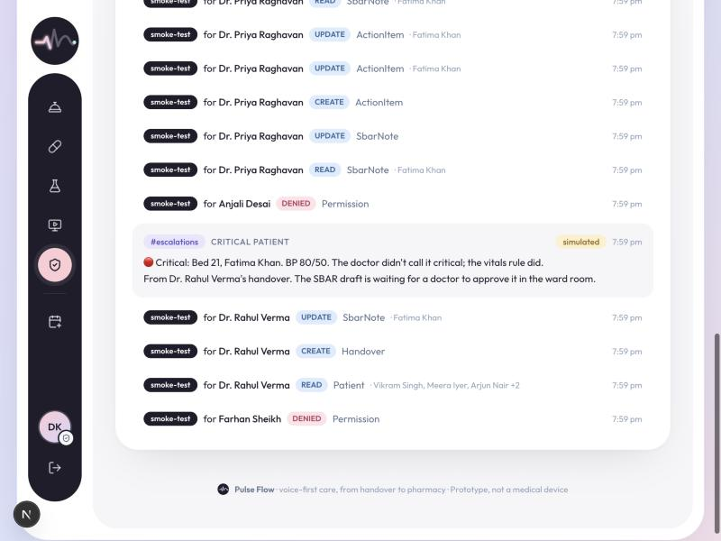

# The ward WhatsApp group, with agents in it: building Pulse Flow on Switch

*Cover image: `docs/assets/pulse-flow-cover.png`. In-post image: `docs/assets/switch-rooms-audit.jpg`.*

It's 3 AM in a medicine ward. The night resident has twelve patients and a phone. Handover happens the way it has for years: a long voice note or a wall of text in the ward WhatsApp group, sent between admissions. Somewhere in message 34 she typed "bed 21 stable, BP 80/50 at 2". The day team reads "stable" and moves on.

Nobody did anything wrong. The channel did. A chat group is fast, everyone is already in it, and it costs nothing, which is exactly why hospitals use it. But it has no idea what a patient is. It can't tell a critical BP from a lunch order, it doesn't know who approved what, and when something goes wrong there's no trail.

I built Pulse Flow for the [Flip the Switch hackathon](https://www.wemakedevs.org/hackathons/switch). This post is about one decision: **instead of asking doctors to leave the chat app, put the agents in the chat app.** That's what Switch is for, and if you've never used Switch, this is also a walkthrough of how a real multi-agent workflow fits together.

## Why chat, and why it fails

The evidence that handovers are where things go wrong is old and consistent. Communication failures contribute to about two-thirds of sentinel events in hospitals, and over half of those involve handoffs ([review, PMC](https://pmc.ncbi.nlm.nih.gov/articles/PMC9923540)). Structured handoffs help: after the I-PASS method was rolled out across 32 hospitals, handoff-related adverse events reported fell by about 47% ([coverage of the study](https://www.hcinnovationgroup.com/clinical-it/patient-safety/news/21286309/study-i-pass-hand-off-program-helps-reduce-patient-harm)). Most of these studies are before-and-after, not randomised, so treat the exact numbers with care; the direction is not in doubt.

In India specifically, WhatsApp is the default clinical back-channel. A review of WhatsApp in clinical practice found more published papers from India than from anywhere else ([PMC](https://pmc.ncbi.nlm.nih.gov/articles/PMC5856937)). In one survey of medical professionals, mostly Indian, about 57% said they share patients' records with colleagues over apps and about 59% didn't get consent to do so ([PMC](https://pmc.ncbi.nlm.nih.gov/articles/PMC4975831)). A NICU team that used WhatsApp for quality improvement found it worked well for spreading information, and also that it made everyone reachable all the time ([BMJ Innovations](https://innovations.bmj.com/content/4/1/5)). These are small studies. I couldn't find a trustworthy national figure for "how many hospitals use WhatsApp", and I'd rather say that than make one up. Anyone who has worked in an Indian hospital will tell you the group exists.

So the problem isn't that doctors use chat. It's that the chat doesn't understand medicine and nothing in it is accountable.

## What Pulse Flow already did

Before the hackathon, Pulse Flow was a voice-first web app. A resident holds the Wispr Flow key and talks through the ward; Pulse Flow turns the ramble into one SBAR note per patient (Situation, Background, Assessment, Recommendation), catches self-corrections like "start fluids, no wait, hold fluids", and runs deterministic rules over the vitals. If the doctor says "stable" but the BP is 80/50, the patient is flagged critical anyway. Nothing reaches the chart until a named doctor approves it, and every read and write goes into an audit log built for India's DPDP Act. The same pattern runs the OPD: dictate a prescription, a consultant signs it with their HPR ID, and it flows to pharmacy and lab.

It worked, but it was another app to open at 3 AM. The ward group was still where people actually were.

## The Switch idea in one paragraph

[Switch](https://docs.switchagents.ai/switch-rooms/getting-started) is open-source infrastructure that turns each channel in your team's chat app (Slack, Discord, Telegram, Mattermost, Teams) into a **room** where people and AI agents work together. You bring the agents: a Claude Code or Codex session on your laptop, or your own agent speaking Switch's protocol. Switch handles membership, who can address which agent, links between rooms, and mirroring to the chat app. You describe a whole workflow (agents, their instructions, rooms, links) in one **template** file and deploy it from Switch Console.

That maps onto a hospital almost one to one.

## The design: four rooms, four agents, one rule

| Room | Who's in it | What happens |
|---|---|---|
| `#ward` | PGs, consultants, **ward-scribe**, **ward-coordinator** | Handover or a consultant's rounds feedback posted (dictated with Wispr Flow) → SBAR drafts → a doctor replies "approve all"; the coordinator chases what's late |
| `#escalations` | consultants, ward-scribe, ward-coordinator, **opd-desk** | Critical patients, emergency walk-ins, stuck tasks and the 8 AM ward brief arrive here |
| `#opd-desk` | front desk, opd-desk | "walk-in Ramesh 54, chest pain" → token, room, doctor |
| `#fulfilment` | pharmacy, lab, **fulfilment** | Signed prescriptions arrive; "DER-001 ready" moves the order |

We ran it on **Telegram**, because that's closest to the WhatsApp groups hospitals actually use: one group per room, one Switch bot in each, and you address an agent by starting your message with its name.

Plus one more agent with no brain at all: **pulse-flow-events**, which is just Pulse Flow posting into rooms when something happens (a critical patient, a signed prescription, an emergency at the desk), whether it happened in the web app or through another agent.

The one rule: **agents act *for* people, never *as* themselves.** Every tool call names the person whose message asked for it, and that person's role decides what happens. If the receptionist types "approve all" in the ward room, the agent tries, Pulse Flow refuses (front desk can't approve clinical notes), the refusal is logged, and the agent explains who can. That one rule is what makes it safe to put an agent in a clinical chat room.



## Agents that do the work people do, not the decisions people make

Flip the Switch asks for agents that get real work done, and it's tempting in healthcare to read that as "the agent decides". We went the other way: the agents take the *clerical* work off people and leave every clinical call with a doctor. Two of them show the difference best.

**The consultant's rounds.** On a ward round, the consultant says "ICU-2: wean the norad by noon, stop the 6 AM ABG, start feeds", and a resident spends the next hour writing it up and fixing the task list. In the ward group, the consultant says it once. The scribe merges it into that patient's care plan as a draft: new tasks, stopped tasks (only ones that really exist in the plan), an updated SBAR. Only the consultant can approve a rounds draft. A PG trying to is refused by Pulse Flow, not by the prompt.

**The ward coordinator.** This is the agent that works without being asked. Every 15 minutes Pulse Flow checks what's late: tasks past the time the doctor dictated ("repeat ABG at 6 AM", parsed into a real deadline), STAT orders not done in 30 minutes, notes no doctor has approved. If anything is, Pulse Flow's events agent posts a follow-up check *addressed to the coordinator by name*, which is how one agent wakes another in Switch. The coordinator then does what a charge nurse does: asks the PG on duty by name, and if the same item comes back on the next check, escalates to that patient's consultant in the escalations group. When someone replies "done", it closes the task as them. It never approves anything and never decides that something is done.

The split matters: Pulse Flow computes *what* is late (deterministic, tested, the same every time), and the agent decides *how* to chase it in a human way. That's the pattern I'd reuse anywhere: let code own the facts, and let agents own the follow-through.

## How it's built (and how you'd build your own)

If you're new to Switch, here are the three pieces you need for any "agents that do real work" project. None of them are hospital-specific.

**1. Give the agents tools, not access.** The agents are Claude Code sessions that Switch Console runs in a working directory. I gave each directory a `.mcp.json` that starts Pulse Flow's own [MCP](https://modelcontextprotocol.io) tool server, so the agent's only way to touch hospital data is a dozen narrow tools: `ward_board`, `submit_handover`, `approve_handover_note`, `register_walk_in`, `update_pharmacy_order` and so on. Each tool has a strict input schema, and each agent only gets its own subset (the fulfilment agent has no idea `approve_handover_note` exists). `npm run switch:setup` writes those directories, so a fresh clone is one command away.

```json
{ "mcpServers": { "pulse-flow": {
  "command": "…/node_modules/.bin/tsx",
  "args": ["--env-file", "…/.env", "--conditions=react-server", "…/switch/mcp/server.ts"],
  "env": { "PULSE_FLOW_AGENT": "ward-scribe", "PULSE_FLOW_FACILITY": "lotus-ridge",
           "PULSE_FLOW_TOOLS": "ward_board,submit_handover,approve_handover_note,discard_handover_note,complete_task" } } } }
```

**2. Describe the workflow as a template.** One YAML file declares the agents (provider, working directory, instructions, who may address them), the rooms (with a kickoff message and a "How this room works" doc pinned in the ward room) and the links between rooms. Importing it in Switch Console creates everything at once. This was the most pleasant surprise: the template *is* the documentation of how the hospital's communication works.

```yaml
agents:
  - name: "{team}-ward-scribe"
    provider: claude
    addressing: anyone
    directory: "{pulse_flow_dir}/switch/agents/ward-scribe"
    instructions: |
      When a doctor posts a handover, call submit_handover with actor = their chat name…
      Only call approve_handover_note when a doctor explicitly approves that note in the room.
rooms:
  - name: "{team}-ward"
    agents: ["{team}-ward-scribe", "{events_agent}"]
links:
  - { from: "{team}-ward", to: "{team}-escalations", label: escalations }
```

**3. Let your app talk into rooms too.** Agents reacting to people is half of it. The other half is the system announcing things. Switch's agent protocol lets a registered agent post to a room with one HTTP call (`POST /agents/{id}/message` with `{room_id, content}`), so `npm run switch:register` registers `pulse-flow-events`, and Pulse Flow posts 🔴 / 🚨 / 🧾 events as they happen. Without Switch configured, those posts are *simulated* and shown in the audit screen, so the app never breaks because chat is down.

## A detail I'm glad I tested

Switch made one more thing possible: Pulse Flow no longer needs its own AI key for the chat workflow. If the server has no Gemini or Claude key, the `submit_handover` tool says so, and the ward scribe (which is already Claude Code) structures the handover itself into the same schema. Pulse Flow then runs the exact same clinical rules over it. A judge with Claude Code and Switch Console can run the whole thing without signing up for anything else.

Writing the tests for that path caught a real bug. The vitals rule understood "BP 80/50" and "80 over 50", but not **"BP 80 by 50"**, which is how a lot of Indian doctors actually say it. A critical pressure said that way would have slipped past the override. It's fixed, with a test, but it's a good reminder of why the deterministic layer has to be tested on how people really talk.

## What I'd tell you before you build on Switch

- **Start from the templates in the Switch repo** (`examples/agent-templates`). The support-desk one (two agents, two linked rooms) is 90% of any escalation workflow.
- **Put identity in every tool.** Chat names are messy ("Dr Suresh", "@suresh.menon"). I match them to staff with a small function that refuses anything ambiguous and lets you map handles in `.env`. In production you'd bind chat accounts to SSO.
- **Keep the agent's instructions about behaviour, and the rules in code.** The instructions say "only approve after a doctor says so". The code makes sure only a doctor *can*.
- **Make the "no server" path useful.** Simulated posts in an audit screen meant I could build and test everything before connecting a live chat app.

## Limits, honestly

This is a prototype with fictional patients. Chat identity is matched by name, not SSO. Patient names go into staff rooms, as they already do in WhatsApp; a hospital that needs data on its own servers should self-host Switch with Mattermost. The agents draft and route; they never diagnose, and prescriptions are still signed only in the app with the consultant's HPR ID.

But the shape feels right. Doctors keep the chat app they already live in. The 3 AM handover becomes eleven SBAR notes, one red flag that reaches the consultant on its own, and a record of who approved what. The change is small for the doctors, and it gives the hospital a lot more control.

*Code, setup and a 3-minute script: [switch/README.md](../switch/README.md).*
