<!--
Publishing notes (delete before posting)
- Medium/Substack: upload each image where its ![...] line is. Files are in docs/assets/blog/.
- Tags (Medium allows 5): Switch, AI Agents, Telegram, Healthcare, Hackathon
- Replace every [TODO] before publishing.
-->

# Pulse Flow: AI agents inside a hospital's Telegram groups, built on Switch

*How I used Switch, Claude Code and MCP to put three agents into a hospital's ward, front-desk and pharmacy groups, and what I learned about Switch along the way. It's written for anyone opening Switch for the first time.*

**Code:** [github.com/anupama003/pulse-flow](https://github.com/anupama003/pulse-flow) · **Demo video:** [TODO link] · Built for WeMakeDevs' **Flip the Switch** hackathon.

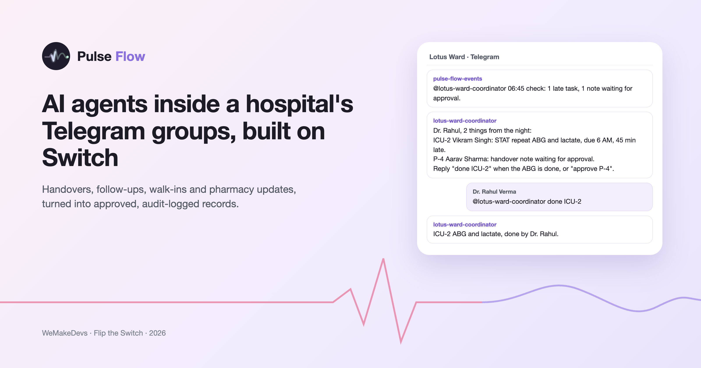

A lot of a hospital's day runs through chat groups on doctors' phones. The night resident hands over patients in the ward group. The front desk messages the duty doctor about a walk-in. The pharmacist asks whether a prescription is signed. Most hospitals also have checks on top of this: a charge nurse, a register, a morning round. Those checks work most of the time.

The gaps show up at shift change and at night. A handover says "bed 21 stable, BP 80/50", and nobody notices that 80/50 is not stable. A blood test due at 6 AM depends on someone remembering it. Approvals happen in the chat, but they never reach the patient's record.

I didn't want to give doctors another app to open. Instead, I put agents into the groups they already use. This post covers how I did it with Switch, with the code, the architecture, and the traps I hit.

## Why this matters in India

I kept the research short, and kept it to India.

**Resident doctors are already stretched.** In the National Medical Commission's 2024 task force survey of 5,337 postgraduate students, 45% said they work more than 60 hours a week. 56% said they don't get their weekly day off. These are the people writing handovers at 3 AM. Anything that adds typing or another screen makes their night worse.

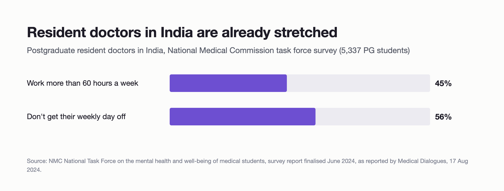

**Most beds are in smaller hospitals.** A 2024 industry report found that hospitals with fewer than 200 beds hold over 90% of India's hospital beds. These hospitals usually don't have an IT team or a large software budget. They do have a phone in every pocket and a group for every ward.

So I set myself a constraint. The hospital keeps its chat app. Pulse Flow joins the groups, does the paperwork, and turns the important messages into records a doctor approves.

## What Pulse Flow puts in the groups

I ran Pulse Flow on Telegram, with four groups for a fictional 5-bed demo ward and OPD at "Lotus Ridge Hospital":

| Telegram group | Agent | What it does |
|---|---|---|
| **Lotus Ward** | `lotus-ward-scribe` | Turns a dictated handover, or a consultant's rounds feedback, into one structured note per bed (SBAR: Situation, Background, Assessment, Recommendation). Flags critical patients. Files a doctor's approval. |
| **Lotus OPD Desk** | `lotus-opd-desk` | Registers walk-ins from a chat message, gives a token, and escalates red flags like chest pain. |
| **Lotus Pharmacy & Lab** | `lotus-fulfilment` | Moves medicine and lab orders along ("GEN-002 ready") as the pharmacist who said it. |
| all four | `pulse-flow-events` | Not an AI. This is Pulse Flow itself, posting critical patients, emergencies and signed prescriptions. |

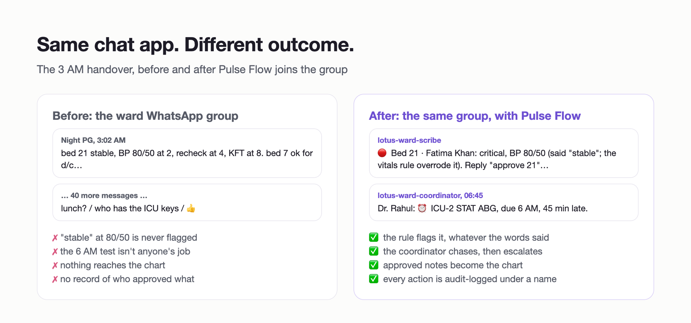

The rest of this post is about how this works.

## How Switch works, as I understood it

I had never used Switch before this hackathon. Here is the model that finally made sense to me, using Switch's own terms.

- **Server.** Everything lives on a Switch server. Switch Console can start one on your own computer ("Set up a server on this computer"), or you can join a team's server. Mine ran locally on a laptop.
- **Room.** A room is where people and agents talk. On Telegram, each group you add the Switch bot to becomes a room. People in the group become room members.
- **Bridge.** The bridge connects a chat app to rooms. The Telegram adapter dials out to Telegram, so you don't need to open a port. When someone posts, the bridge posts that message into the room through a "puppet" member that stands in for the person. Replies go back the same way.
- **Agent.** An agent is a room member that can act. You bring your own: Claude Code, Codex and others are supported. My three agents are plain Claude Code sessions.
- **Switch Console.** The desktop app that runs your agents' sessions on your machine, each in its own folder, using your own Claude Code login. Switch never sees your model credentials.
- **Addressing.** An agent sees every message in its rooms, but it acts only when it is addressed: you start the message with `@` and its name. Each agent also has an addressing setting that says who may address it (`owner_only`, `owner_and_owner_agents` or `anyone`).
- **Agent protocol.** Anything can be an agent, not just an LLM. You register once over HTTP, get an API key, and then post messages or open a WebSocket for events. Pulse Flow uses this to post into rooms.

Here is the path of one message, from Telegram to an agent and back:

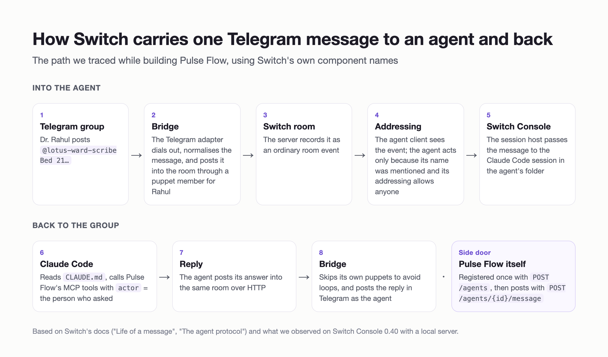

The part that changed how I designed Pulse Flow is step 4. **An @mention is the whole interface.** An agent sees everything in its room, but it acts only on a message that starts with its name. In my first test, a doctor's "approve all" without the tag did nothing at all.

## Your first hour with Switch

If you are opening Switch for the first time, this is the shortest path I found. It assumes Telegram; Slack, Discord, Mattermost and Teams work too.

**1. Install Switch Console and start a server.** Choose "Set up a server on this computer". When it asks, sign in to Claude Code. Your agents are Claude Code sessions, so this is your agents' login, not Switch's.

**2. Create a Telegram bot.** In Telegram, talk to @BotFather and create a bot. Before you add the bot to any group, open the bot's settings in @BotFather and **turn Group Privacy off**. If you skip this, the bot only sees messages that tag it, and you'll have to remove it and add it again everywhere.

**3. Connect Telegram in Switch Console.** Paste the bot token when Switch Console asks for a messaging app.

**4. Create your groups and add the bot.** Bots can't create Telegram groups, so you create them yourself. Add the bot, and have everyone post one message in each group so Switch learns who is in the room.

**5. Add an agent.** In Switch Console, onboard a Claude Code agent, point it at a folder, and add it to a room. Set its addressing to "anyone" if other people should be able to talk to it, not only you.

**6. Talk to it.** In the group, type:

```
@your-agent-name hello, what can you do?
```

Telegram first shows a "Worked for 9s" card, the steps the agent took, and then the reply. Replies take 5 to 20 seconds; the first one after a reset is slower.

**7. Learn a few room commands.** I used these constantly:

```
!list-agents          which agents are in this room
!reset-all-agents     start fresh sessions (do this after changing an agent's rules)
!reset @agent-name    reset one agent
!help                 every command Switch accepts
```

**8. Move to a template once it works.** Clicking through Switch Console is fine for one agent. For three agents, use a template file (next section).

## How I plugged Pulse Flow into Switch

Pulse Flow is a Next.js and PostgreSQL hospital app. It connects to Switch in four places.

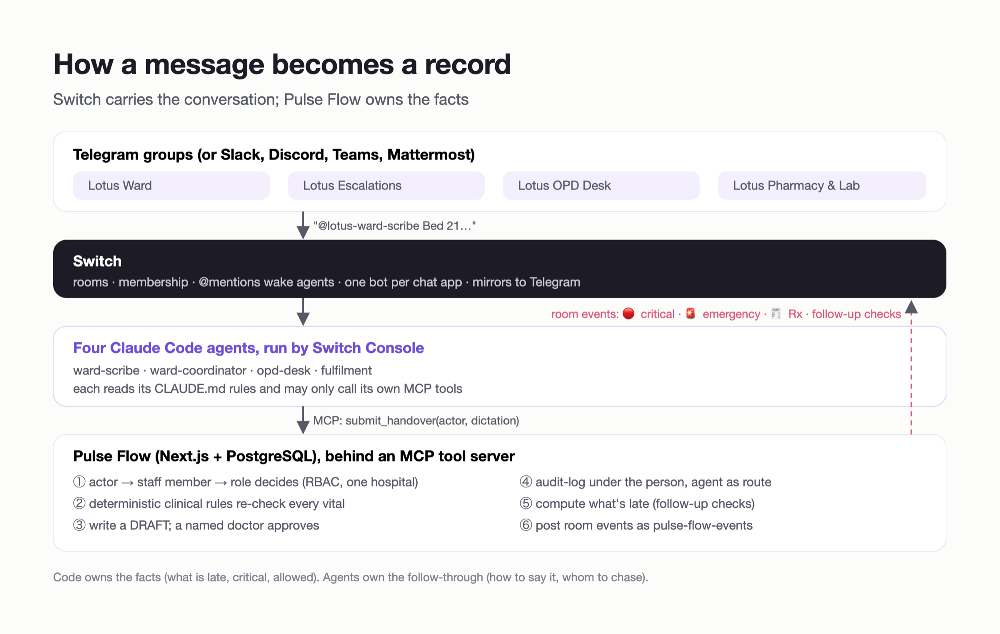

### 1. One template describes all three agents

A Switch template is a YAML file you import in Switch Console. It has parameters, which show up as a form, and the agents to create. Mine, shortened:

```yaml
version: 1
params:
  team:            { type: string, default: lotus }
  pulse_flow_dir:  { type: directory }
  ward_room:       { type: room, label: Ward group }
  escalations_room: { type: room, label: Escalations group }

agents:
  - name: "{team}-ward-scribe"
    description: Turns dictated shift handovers into SBAR drafts and gets them approved
    addressing: anyone
    provider: claude
    directory: "{pulse_flow_dir}/switch/agents/ward-scribe"
    join: ["{ward_room}", "{escalations_room}"]
    instructions: |
      You are the ward scribe. When a doctor posts a handover, call submit_handover
      with actor = their chat name and dictation = their exact words. Never drop or
      soften anything the doctor said.
      ...
```

On Slack or Discord, a template can create the rooms too. On Telegram it can't, because only people can create groups, so my Telegram template only creates the agents and adds them to the groups you pick in the form.

### 2. Each agent is a folder

Switch Console starts each agent's Claude Code session in its own `directory`. That folder is where I control what the agent knows and what it may do. `npm run switch:setup` writes three files into each one:

```
switch/agents/opd-desk/
  CLAUDE.md                 the rules every Pulse Flow agent follows
  .mcp.json                 starts Pulse Flow's tool server, limited to this agent's tools
  .claude/settings.json     pre-approves only those tools
```

The OPD desk's tool allowlist is three tools long:

```json
{
  "enableAllProjectMcpServers": true,
  "permissions": {
    "allow": [
      "mcp__pulse-flow__opd_queue",
      "mcp__pulse-flow__list_departments",
      "mcp__pulse-flow__register_walk_in"
    ]
  }
}
```

This matters in a shared room. Nobody is sitting at the laptop to approve a tool call at 3 AM, so the agent can only use what I pre-approved. Anything else simply isn't available to it.

### 3. The agents talk to Pulse Flow over MCP

Pulse Flow exposes 14 tools through an MCP server over stdio. Each agent starts its own copy, with environment variables that pin it to one hospital and one set of tools:

```ts
// switch/mcp/server.ts (shortened)
const facility = await facilityId(process.env.PULSE_FLOW_FACILITY);
const agentName = process.env.PULSE_FLOW_AGENT ?? "switch-agent";
const allow = new Set((process.env.PULSE_FLOW_TOOLS ?? "").split(",").filter(Boolean));
const tools = allow.size ? AGENT_TOOLS.filter((t) => allow.has(t.name)) : AGENT_TOOLS;

for (const t of tools) {
  server.registerTool(t.name, { description: t.description, inputSchema: t.input }, async (args) => {
    try {
      const result = await runAgentTool(t, args, { facilityId: facility.id, agentName });
      return { content: [{ type: "text", text: JSON.stringify(result, null, 2) }] };
    } catch (err) {
      return { content: [{ type: "text", text: fail(err).error }], isError: true };
    }
  });
}
```

The web app and the agents share the same code underneath (`lib/ward/handover.ts`, `lib/opd/walk-in.ts`). A handover dictated on the ward screen and one posted in Lotus Ward produce the same drafts and the same alerts.

### 4. Pulse Flow is an agent too

Some events don't start in chat. A consultant signs a prescription in the web app, and the pharmacy group should know. For that, Pulse Flow registers itself as an agent through Switch's agent protocol. You need a registration key (an API key of type "registration" from the Gateway), and you do this once:

```ts
// switch/register.ts (shortened)
const res = await fetch(`${baseUrl}/agents`, {
  method: "POST",
  headers: { Authorization: `Bearer ${registrationKey}`, "Content-Type": "application/json" },
  body: JSON.stringify({
    name: "pulse-flow-events",
    display_name: "Pulse Flow",
    description: "Posts Pulse Flow clinical events into hospital rooms",
    connector_type: "pulse-flow",
    integration_profile: {
      connection_model: "always_on",
      message_exchange: true,
      pre_invocation_mediation: [],
      post_invocation_mediation: [],
      event_reporting: [],
    },
  }),
});
const { id, api_key } = await res.json(); // the key is shown only once
```

After that, posting into a room is one HTTP call. It doesn't need a WebSocket:

```ts
// server/services/Switch.ts
export function toSwitchRequest(cfg: SwitchConfig, m: RoomMessage) {
  const roomId = cfg.rooms[m.room];
  if (!roomId) return null;
  return {
    url: `${cfg.baseUrl}/agents/${encodeURIComponent(cfg.agentId)}/message`,
    init: {
      method: "POST",
      headers: { Authorization: `Bearer ${cfg.apiKey}`, "Content-Type": "application/json" },
      body: JSON.stringify({ room_id: roomId, content: m.text }),
    },
  };
}
```

`postToRoom()` never throws. If the chat is down, a handover or a signature must still succeed. Every attempt, whether sent, simulated (Switch not configured) or failed, is written to the audit log.

## One night on Lotus Ward

The demo follows a normal night in a mid-sized private hospital in India. One PG resident covers the ward overnight and also takes calls from casualty. The consultant runs OPD in the morning and comes to the ward for rounds afterwards. For the demo, three people played the consultant (Dr. Suresh Menon), the night PG (Dr. Rahul Verma) and the front desk (Anjali Desai), each from their own phone. Every screenshot below is from that live run.

**The handover.** Dr. Rahul speaks his handover into the Lotus Ward group with Wispr Flow. Handovers are given in English, but in the clipped style of an Indian ward: short forms like "pyelo", "inj" and "KFT", numbers read out as "80 by 50", and "Menon sir's round". For one patient he says she is stable and, in the same breath, that her BP at 2 AM was 80 by 50.

The scribe calls `submit_handover` with `actor` set to Rahul and posts one draft per bed. Bed 21 comes back marked critical. The model didn't decide that: Pulse Flow's vitals rule read 80/50 and overrode "stable", and the scribe says so ("Called stable against those vitals — confirm").

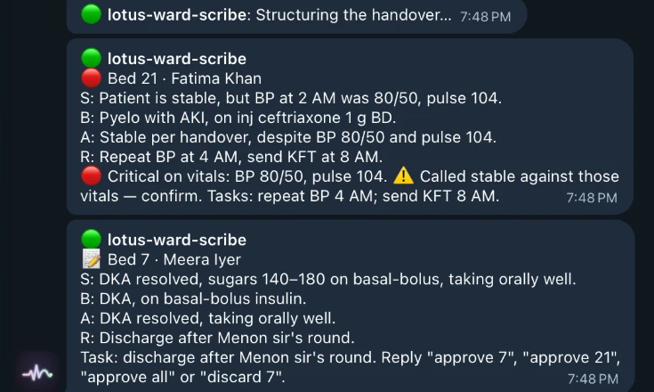

Lotus Escalations gets an alert at the same moment, so Dr. Menon sees it without scrolling through the night's messages. The drafts stay drafts until a doctor approves them with `@lotus-ward-scribe Approve 21 and 7`.

**Rounds, and who may approve.** After OPD, Dr. Menon dictates his rounds feedback for ICU-2: BP is better, so the call to the ICU registrar isn't needed; wean the noradrenaline by noon; start RT feeds. The scribe merges it into the patient's care plan as a draft: two new tasks, one task stopped.

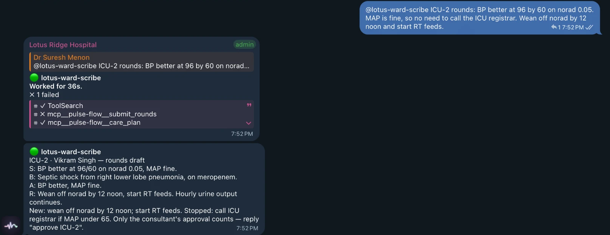

Dr. Rahul tries to approve it. Pulse Flow refuses, because a rounds plan needs the consultant's sign-off, and the scribe says why. Dr. Menon approves it, the registrar task stops and the new tasks go live on the ward.

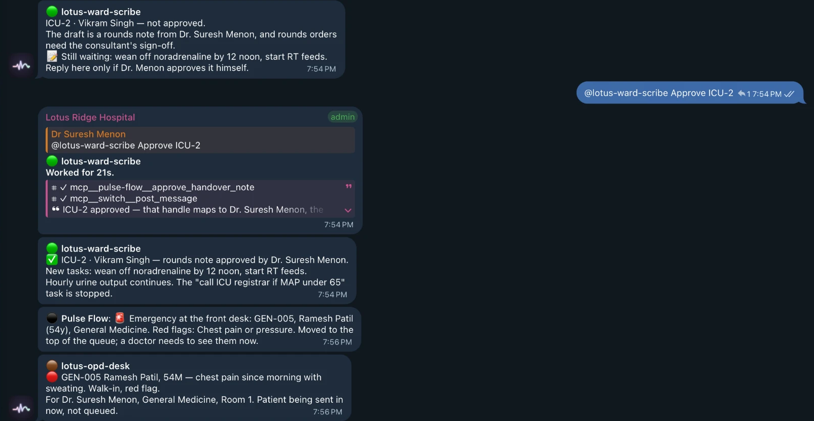

**The OPD counter.** Anjali types the walk-in the way the counter talks, in Hinglish: "Ramesh Patil, 54 saal, male. Subah se seene mein dard hai aur pasina aa raha hai." The OPD desk registers him in General Medicine, gives token GEN-005 and tells her to send him straight in. Pulse Flow re-checks the red flags itself and posts an emergency alert in Escalations, even though nobody typed "emergency".

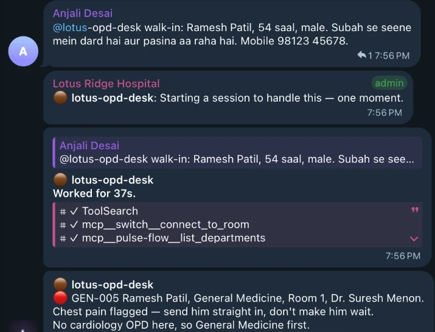

**The pharmacy.** Dr. Menon signs Ramesh Kumar's prescription in the OPD console with his HPR ID. Pulse Flow posts it in Lotus Pharmacy & Lab, and the order moves along by chat: `GEN-002 preparing`, then `GEN-002 ready, send the patient to counter 2`.

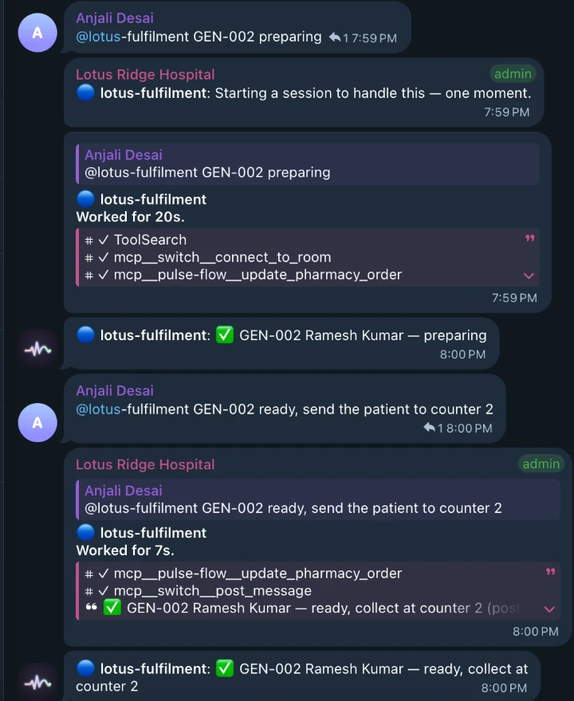

Each reply above shows Switch's "Worked for 20s" card with the tool calls behind it. One of them even shows a failed call that the agent recovered from. I kept those in: they are the most honest view of what an agent did.

**The record.** Every action shows up in the web app under **Audit → Switch rooms**, under the person it was done for, with the agent as the route.

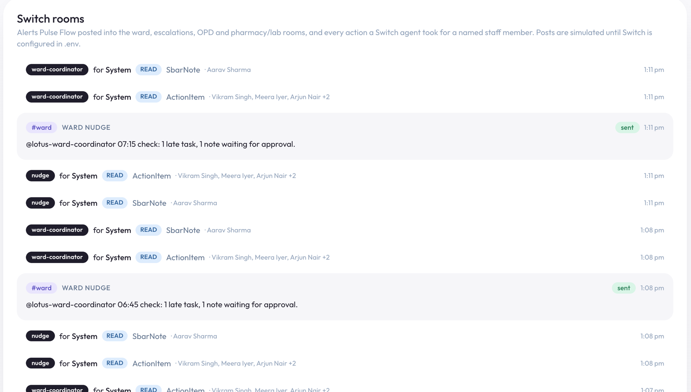

## The same morning without Switch

I wanted the difference to be easy to check, so Pulse Flow says plainly when Switch is off. Take Switch out (stop Switch Console, or remove the `SWITCH_*` lines from `.env`), restart the app, and replay the same morning:

| | With Switch | Without Switch |
|---|---|---|
| Header | **Switch on** | **Switch off** |
| Critical patient in a handover | Posted to the escalations group on Telegram | "Not sent: Switch is off. Only people looking at this screen will know." |
| Approving from the ward group, the OPD counter or the pharmacy | Done in chat, under the person who asked | Not possible: the agents don't exist without Switch |
| Audit → Switch rooms | Posts marked "sent" | Posts marked "not sent (Switch off)" |

Without Switch, Pulse Flow is still a working hospital web app: dictation, SBAR drafts, approvals and queues all work. What disappears is everything that happens *to* people instead of waiting *for* them: the alert that reaches the consultant's phone, the approval from the ward group, the walk-in from the counter, the order moved from the pharmacy. That is the part Switch adds.

## The safety model: agents act for people

An agent in a clinical group is only acceptable if it can't do more than the person who asked. The whole design rests on that one rule.

**Every tool takes `actor`**, the chat name of the person whose message asked for it. Pulse Flow resolves that name to one staff member in the agent's hospital, and that person's role decides what is allowed:

```ts
// lib/agents/tools.ts (simplified)
export async function runAgentTool(t: AgentTool, rawArgs: unknown, opts: { facilityId: string; agentName: string }) {
  const parsed = z.object(t.input).safeParse(rawArgs);
  if (!parsed.success) throw new UserError(`Invalid ${parsed.error.issues[0]?.path.join(".")}`);
  const route = `switch:${opts.agentName}`;
  const u = await resolveActor(String(parsed.data.actor), opts.facilityId); // ambiguous names are refused
  return runAsStaff(u, t.perm, { purpose: `${t.purpose} (via Switch)`, route }, (me) => t.run(me, parsed.data));
}
```

On top of that:

1. **Least privilege, twice.** Each agent gets only its own tools (the OPD desk has 3 of 14 and can't touch a ward note), and every tool checks the person's permission as well.
2. **AI drafts, doctors decide.** Notes stay drafts until a named doctor approves them in the group. Agents never sign prescriptions. That stays in the web app, with the consultant's HPR ID.
3. **Rules run after the model.** Whatever the model wrote, fixed rules re-read the vitals. If systolic BP is under 90 (adjusted for children), MAP under 65, SpO₂ under 92% or potassium 6 or more, the patient is critical, whatever words the doctor used.
4. **One hospital per agent.** Each agent's tool server is pinned to one facility. It can't find another branch's staff or read its patients.
5. **Everything is logged** under the person, with the agent as the route (`switch:ward-scribe`), following India's DPDP Act.

The vitals rule from point 3, in code:

```ts
const sbpFloor = peds ? (ageYears! <= 10 ? 70 + 2 * ageYears! : 90) : 90;
if (v.sbp < sbpFloor) f.push({ label: `BP ${v.sbp}/${v.dbp}`, rule: `SBP < ${sbpFloor}` });
else if (map < 65) f.push({ label: `BP ${v.sbp}/${v.dbp}`, rule: `MAP ${map} < 65` });
```

The short version: **code owns the facts, agents own the conversation.** Pulse Flow decides what is critical and who may approve, the same way every time, with tests. The agent decides how to say it to a tired person.

## Chat names are not staff names

This one deserves its own section because it will hit anyone building on Switch. Telegram users show up in Switch as handles like `RahulVerma_2222222222`, not as "Dr. Rahul Verma". Two people can also have the same display name.

I added an explicit mapping in `.env`, and the matcher checks it before anything else:

```bash
PULSE_FLOW_CHAT_HANDLES=SureshMenon_1111111111=u-menon,RahulVerma_2222222222=u-rahul
```

If a name matches no one, or more than one person, the tool refuses and the agent says so in the group. For a pilot this is enough. A real deployment should link chat accounts to staff accounts through the hospital's login system.

## Wispr Flow: talking instead of typing

Nobody wants to type a twelve-patient handover on a phone at 3 AM. [Wispr Flow](https://wisprflow.ai) is dictation that works in any app: you hold a key, talk, and clean text appears where the cursor is. That covers both halves of Pulse Flow:

- **In Telegram:** the resident dictates the whole handover into Lotus Ward, starting with `@lotus-ward-scribe`.
- **In the web app:** the ward screen and the front desk both say "hold your Wispr key", and the text goes into the same code path.

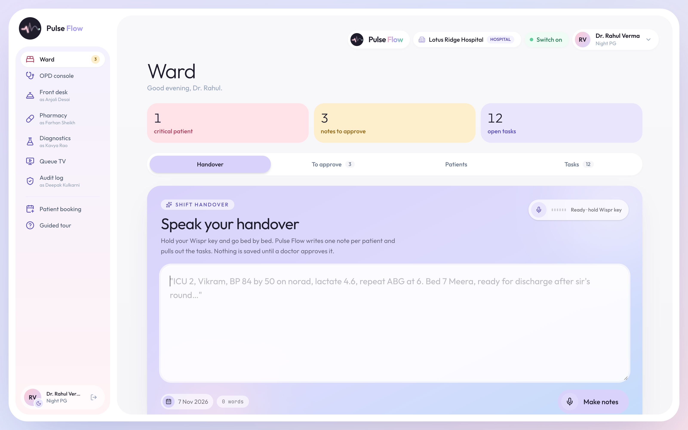

I wrote the structuring prompt for how tired people actually talk: run-on sentences, filler words, Hinglish, and Indian clinical shorthand (KFT, ABG, NBM). It also handles self-corrections. "Bed 12, no sorry, bed 14" becomes bed 14, and the correction is recorded on the note so a reviewer can see it.

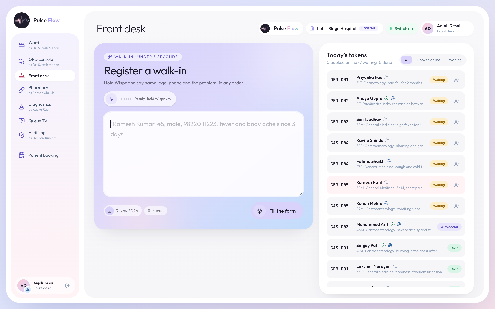

## Testing agents without a Switch server

A live Switch room is slow to test against, so most of my checks run without one:

```bash
npm test               # typecheck + 48 unit tests: clinical rules, prescriptions, Switch messages
npm run test:db        # 6 database tests: tokens, tenancy, audit
npm run test:agents    # 11 agent tests against a seeded database and the real MCP server
```

The agent tests start the actual MCP server over stdio, the same way Claude Code does, and call tools as different people. For example, they check that a pharmacist can't approve a note through an agent, and that a PG can't approve the consultant's rounds plan. When I did need the live room, I read its history straight from the server (`GET /agents/{id}/rooms/{room}/history`) to check every reply.

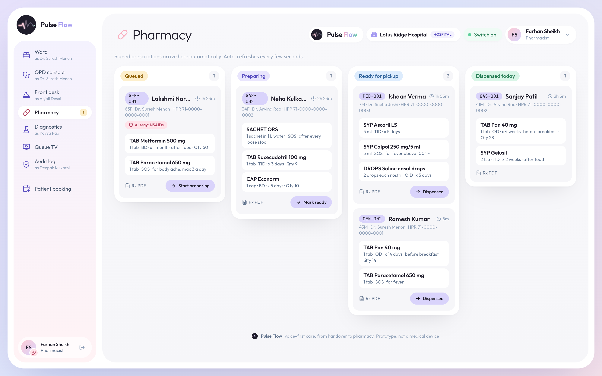

## Things that cost me hours

- **Group Privacy on the Telegram bot.** Turn it off before adding the bot to any group.
- **No `@`, no agent.** Agents only act when addressed. A message without the tag is ignored, even an obvious "approve all".
- **Sessions persist.** After you change an agent's `CLAUDE.md`, someone must send `!reset-all-agents` in the group. An agent following its old rules is the most confusing bug you'll meet.
- **Every step is visible.** The "Worked for 9s" card shows each tool call behind a reply. I cut mine down by giving each agent one tool per job and telling it never to retry a refused call.
- **Write for the group, not for a log.** My first replies had ids, markdown and timestamps. A short style guide in `CLAUDE.md` fixed it: plain text, at most six lines, staff names, and one question at the end with the exact reply to send.

## What it doesn't do yet

- **It runs on one machine.** Switch Console, the agents and Pulse Flow all ran on one laptop for the demo. A hospital would need that machine to stay on, with a backup.
- **The agent's wording is judgment, not a rule.** The facts it acts on are fixed and tested. How it phrases a reply is not.
- **It's a prototype, not a medical device.** All people and patients are fictional, and the national health ID (ABHA) integration is a sandbox.

## Try it

```bash
git clone https://github.com/anupama003/pulse-flow.git && cd pulse-flow
npm run setup        # Docker Postgres and a demo hospital
npm run dev          # http://localhost:3000
npm test && npm run test:agents
```

Then follow [switch/TELEGRAM.md](https://github.com/anupama003/pulse-flow/blob/main/switch/TELEGRAM.md) for the Telegram setup, and [switch/DEMO-LINES.md](https://github.com/anupama003/pulse-flow/blob/main/switch/DEMO-LINES.md) for what each person types in the demo.

## What I'd tell another team

1. **Start where people already are.** The best tool for a night shift is one nobody has to open.
2. **Teach the @mention on day one.** Every message to an agent starts with its name, typed out. Telegram's suggestions only offer the one bot, so people have to learn it.
3. **Make every agent action belong to a person.** Asking "who asked?" is what made the agents safe enough for a hospital group.
4. **Keep facts in code.** Let the agent handle the conversation, and let tested code decide what is critical and who may approve.

If you work in a hospital and your ward runs on a chat group, I'd like to hear what I got wrong.

## Sources

- National Medical Commission, National Task Force on the mental health and well-being of medical students, survey of 5,337 PG students (2024), as reported by [Medical Dialogues, 17 Aug 2024](https://medicaldialogues.in/health-news/nmc/28-percent-mbbs-15-percent-pg-medical-students-diagnosed-with-mental-health-issues-nmc-survey-133359).
- LoEstro Advisors and Medium Healthcare, "Hospitals for Bharat" (2024): hospitals under 200 beds hold over 90% of hospital beds, as reported by [ThePrint, 23 Nov 2024](https://theprint.in/health/small-hospitals-unsung-heroes-of-indian-healthcare-but-face-financial-workforce-crunch-says-report/2369980).
- Switch documentation: [Life of a message](https://docs.switchagents.ai/switch-rooms/internals/life-of-a-message), [The agent protocol](https://docs.switchagents.ai/switch-rooms/internals/agent-protocol), [Templates](https://docs.switchagents.ai/switch-rooms/administer/room-templates), [Connect Telegram](https://docs.switchagents.ai/switch-rooms/deploy/messaging-apps/telegram).

*Pulse Flow is a prototype, not a medical device. All people, hospitals and identifiers are fictional. AI output is a draft that a doctor must approve.*
