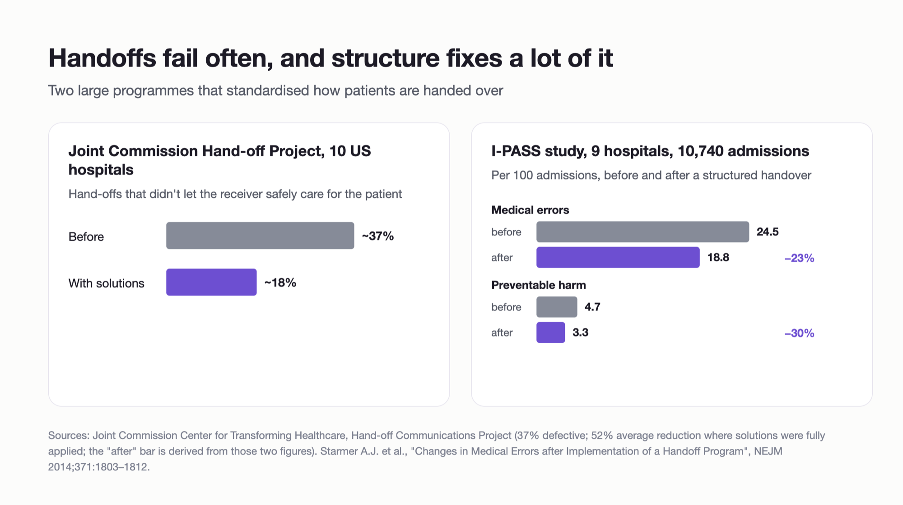
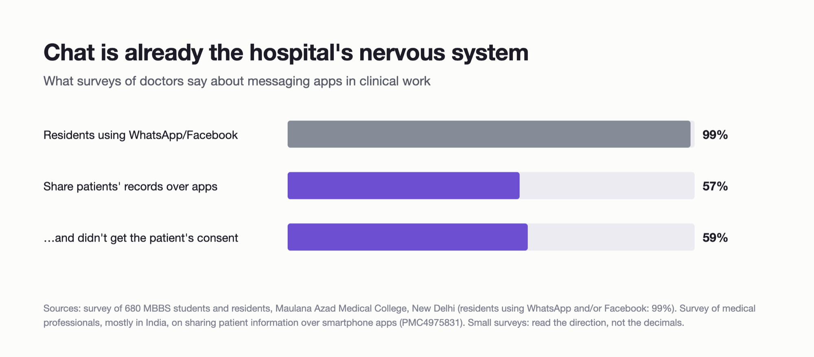
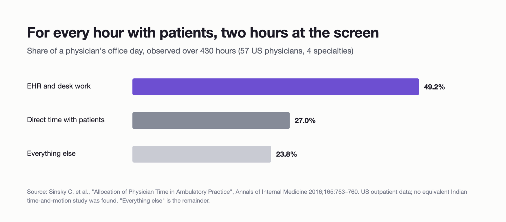
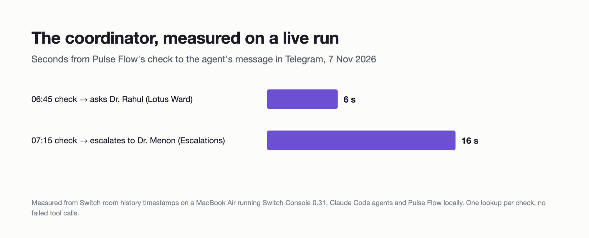
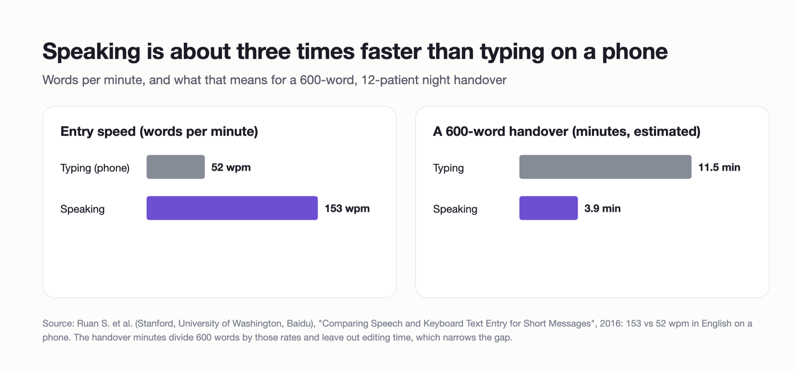
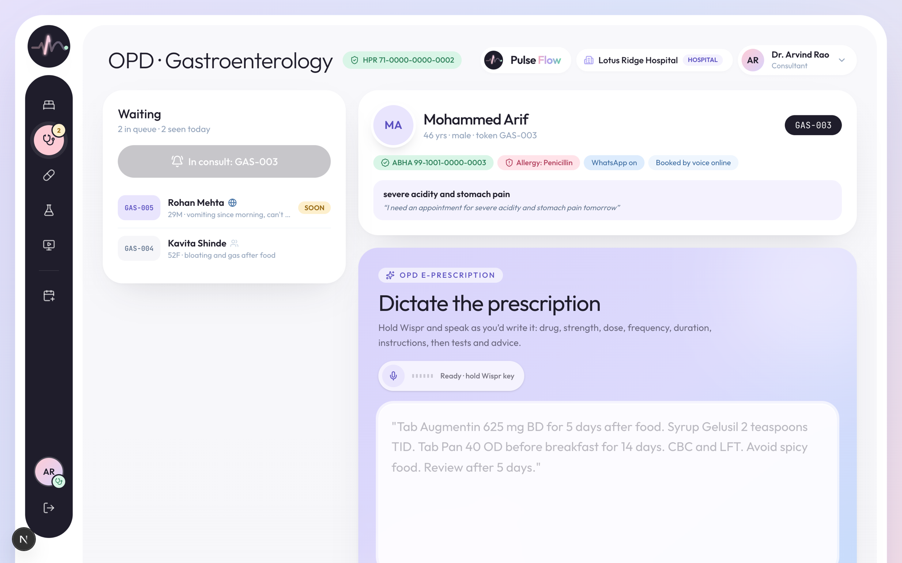

<!--
Publishing notes (delete before posting)
- Shorter, 100% code-free variant? Cut sections 4's code blocks and 8; keep the rest.
- Medium/Substack: upload each image where its ![...] line is. Files are in docs/assets/blog/.
- Images marked [YOU CAPTURE] are Telegram / Switch Console / Wispr screenshots only you can take.
- Tags (Medium allows 5): Hackathon, AI Agents, Healthcare, Switch, Wispr Flow
- Replace every [TODO] before publishing.
-->

# The 6 AM blood test nobody chased: putting AI agents inside a hospital's chat group with Switch

*At 3 AM, a resident types "bed 21 stable, BP 80/50" into the ward WhatsApp group. Nobody flags it. At 6 AM, a STAT blood gas is due, and nobody chases it. Pulse Flow puts four AI agents inside the chat the hospital already uses, through Switch: one turns a spoken handover into approved patient notes, one chases late work like a charge nurse, one registers walk-ins, and one runs pharmacy. Every action is taken for a named person and lands in an audit log.*

**Code:** [github.com/anupama003/pulse-flow](https://github.com/anupama003/pulse-flow) · **Demo video:** [TODO link] · Built for WeMakeDevs' **Flip the Switch** hackathon (Track 01, Best Business Workflow), with Wispr Flow.


## The short version

- **The problem is the channel, not the doctors.** Indian hospitals coordinate in WhatsApp groups that don't understand medicine, don't follow up, and don't keep records.
- **We didn't build another app for doctors to open at 3 AM.** We put agents in the group they already use, through Switch, on Telegram.
- **The agents act *for* people, never *as* themselves.** Every tool call names the person who asked. Pulse Flow checks that person's role, re-checks every vital with deterministic rules, keeps AI output as a draft until a doctor approves it, and logs everything.
- **Measured on a live run:** the coordinator asked the resident about a late STAT test **6 seconds** after the 06:45 check, and escalated to the consultant **16 seconds** after the 07:15 check, with one tool call each.

## 1. The problem: a hospital runs on a chat group that can't read

Picture a 120-bed private hospital in Pune. The night resident, a postgraduate trainee (the "PG"), covers twelve patients. At 3 AM she hands over the way it has always been done: a long text, or a voice note, into the ward WhatsApp group, between two admissions.

> bed 21 stable, BP 80/50 at 2, recheck at 4, KFT at 8. bed 7 ok for d/c after consultant…

Forty messages later ("who has the ICU keys?", "lunch?", 👍), the day team reads "stable" and moves on. A systolic pressure of 80 isn't stable. The 6 AM blood test on ICU-2 isn't anyone's job in particular, so nobody chases it. Nothing reaches the chart. If something goes wrong, nobody can say who approved what.

Nobody did anything wrong. **The channel did.** That's why we didn't try to replace it.

### What the research says

We looked for numbers, and we're honest about where they're thin.

**Handovers are where things break.** The Joint Commission's Hand-off Communications Project, run across ten US hospitals, found that **37% of hand-offs were defective**, meaning the receiver couldn't safely care for the patient. Hospitals that fully applied its fixes cut defective hand-offs by **52%** on average. The I-PASS study standardised handovers across nine pediatric residency programmes (10,740 admissions) and found medical errors fell **23%** and preventable adverse events **30%** ([Starmer et al., NEJM 2014](https://www.nejm.org/doi/full/10.1056/NEJMsa1405556)).



**Chat is already the channel.** In a survey of 680 MBBS students and residents at Maulana Azad Medical College in New Delhi, **99% of residents** used WhatsApp and/or Facebook. In a survey of medical professionals, mostly in India, about **57%** said they share patients' records with colleagues over apps, and about **59%** didn't get consent ([PMC4975831](https://pmc.ncbi.nlm.nih.gov/articles/PMC4975831)). These are small surveys, so read the direction, not the decimals. We couldn't find a trustworthy national figure for "how many Indian hospitals run on WhatsApp", and we'd rather say so than invent one. Anyone who has worked in an Indian hospital will tell you the group exists.



**Doctors already drown in paperwork.** In a time-and-motion study of 57 US physicians over 430 hours, **49.2%** of the office day went to the EHR and desk work, against **27%** face to face with patients ([Sinsky et al., Annals of Internal Medicine 2016](https://www.acpjournals.org/doi/10.7326/M16-0961)). That's US data; we found no Indian equivalent. Any fix that adds a screen makes this worse. Our fix has to *remove* typing.



**Small and mid-sized hospitals feel this most.** India's secondary care is dominated by small private hospitals and nursing homes, many with fewer than 30 beds and owned by the doctors who run them. They can't afford an enterprise EHR rollout or an IT team. They *already* have a phone in every pocket and a group for every ward.

## 2. The idea: don't make doctors leave the chat; put the agents in it

[Switch](https://www.switchagents.ai) turns each channel in a team's chat app (Slack, Teams, Discord, Mattermost, Telegram) into a **room** where people and AI agents work together. You bring the agents, Claude Code or Codex sessions on your own machine, and Switch handles membership, who can address whom, and mirroring into the chat app.

That maps onto a hospital almost one to one. We ran it on **Telegram**, the closest thing Switch supports to the WhatsApp groups hospitals actually use: one group per room, one bot for all the agents, and you talk to an agent by starting a message with `@` and its name.

| Telegram group | Agent | What it does |
|---|---|---|
| **Lotus Ward** | `lotus-ward-scribe` | Turns a dictated handover, or a consultant's rounds feedback, into one SBAR note per bed (Situation, Background, Assessment, Recommendation). Flags critical patients. Files a doctor's approval. |
| **Lotus Ward** + **Lotus Escalations** | `lotus-ward-coordinator` | The charge nurse who chases. Asks the PG on duty about late tasks and waiting notes; escalates to the patient's consultant if nothing happened after a reminder. |
| **Lotus OPD Desk** | `lotus-opd-desk` | Registers walk-ins from chat, issues a token, and escalates red flags like chest pain, even when nobody types "emergency". |
| **Lotus Pharmacy & Lab** | `lotus-fulfilment` | Moves medicine and lab orders along ("DER-001 ready") as the pharmacist who said it. |
| all four | `pulse-flow-events` | Not an AI: Pulse Flow itself, posting 🔴 critical patients, 🚨 emergencies, 🧾 signed prescriptions and the coordinator's wake-up checks. |


## 3. A night on Lotus Ward, in Telegram

The demo hospital is Lotus Ridge (fictional, seeded with five ward patients and an OPD). Three of us played three staff: the consultant, the night PG, and the front desk.

**3 AM: the handover.** Dr. Rahul, the night PG, holds the Wispr Flow key and talks:

> @lotus-ward-scribe Bed 21 Fatima Khan, pyelonephritis with AKI on IV ceftriaxone, she's stable, BP 80 by 50 at 2 AM, heart rate 104, recheck BP at 4 and repeat KFT at 8. Bed 7 Meera Iyer, DKA resolved, sugars 140 to 180 on basal-bolus, eating well, discharge after consultant review.

The scribe posts two short drafts. **Bed 21 is 🔴 critical, even though the doctor said "stable"**: Pulse Flow's rules read "80 by 50" and override the word. At the same moment, Lotus Escalations gets a 🔴 line from Pulse Flow.

![\[YOU CAPTURE\] Telegram, Lotus Ward: Rahul's dictated handover and the scribe's two drafts, bed 21 marked 🔴](assets/blog/tg-handover.png)

**Who may approve.** Anjali at the front desk tries `@lotus-ward-scribe approve 21`. The scribe tries; Pulse Flow refuses, because a receptionist can't approve a clinical note, and the agent explains who can. Dr. Menon, the consultant, types `@lotus-ward-scribe approve 21 and 7`, and both notes go live under his name.

![\[YOU CAPTURE\] Telegram, Lotus Ward: Anjali refused, Dr. Menon approves](assets/blog/tg-approve.png)

**06:45: nobody asked, and the coordinator chases anyway.** Pulse Flow checks what's late every 15 minutes. The seeded ICU-2 patient has a STAT blood gas due at 6 AM. Pulse Flow posts one line, addressed to the coordinator, which is how one agent wakes another in Switch:

> **pulse-flow-events:** @lotus-ward-coordinator 06:45 check: 1 late task, 1 note waiting for approval.
>
> **lotus-ward-coordinator:** Dr. Rahul, 2 things from the night:
> ⏰ ICU-2 Vikram Singh: STAT repeat ABG and lactate, due 6 AM, 45 min late.
> 📝 P-4 Aarav Sharma: handover note waiting for approval.
> Reply "done ICU-2" when the ABG is done, or "approve P-4".

Rahul replies `@lotus-ward-coordinator done ICU-2`, and the coordinator closes the task *as Rahul*: "✅ ICU-2 ABG and lactate, done by Dr. Rahul."

**07:15: escalation.** P-4's note is still waiting after a reminder, so the coordinator goes up a level, in the escalations group:

> **lotus-ward-coordinator:** Dr. Menon, still open after a reminder to Dr. Rahul:
> 📝 P-4 Aarav Sharma: handover note waiting for a doctor's approval since about an hour and a half.

![\[YOU CAPTURE\] Telegram, Lotus Escalations: the coordinator's escalation to Dr. Menon](assets/blog/tg-escalation.png)

One detail surprised us. When we sent the 06:45 check twice, 90 seconds apart, the coordinator **chose not to escalate**: its reminder had gone out seconds ago, so Rahul hadn't had time to act. That's the judgment a good charge nurse has, and it's why we let an agent own the *how*, while code owns the *what*.



**Consultant rounds.** Dr. Menon dictates feedback for one patient: "ICU-2 rounds: BP better at 96 by 60 on norad 0.05, MAP fine now so drop the ICU registrar call, wean norad off by noon, start enteral feeds." The scribe merges it into ICU-2's care plan as a draft: new tasks, the registrar call stopped (only tasks that really exist can be stopped), and an updated SBAR. **Only the consultant can approve a rounds draft.** A PG trying to is refused by Pulse Flow, not by the prompt.

**The front desk and the pharmacy.** Anjali types `@lotus-opd-desk walk-in Ramesh Patil 54 male, chest pain since morning and sweating`. She gets a token and a room, and 🚨 lands in Escalations, because Pulse Flow re-screens red flags itself. In the OPD console, a consultant signs a prescription with their HPR ID; 🧾 appears in Pharmacy & Lab, and the pharmacist moves it with `DER-001 preparing`, then `DER-001 ready`.

**The record.** Every one of those actions shows up in **Audit → Switch rooms**, under the person it was done for, with the agent as the route.


## 4. How Switch made this possible (and why it couldn't work without it)

Without Switch, Pulse Flow was a good web app that nobody opened at 3 AM. Switch is what moved it into the place where the work already happens. Specifically, Switch gave us five things we'd otherwise have built badly:

1. **Rooms in the chat app people already use.** One Telegram bot, four groups, and Switch turns each into a room with members. No new app for the hospital.
2. **Agents as teammates, addressed by name.** Start a message with `@lotus-ward-scribe` and that agent wakes up. The same mechanism lets **Pulse Flow wake the coordinator**: our events agent posts "@lotus-ward-coordinator 06:45 check", and Switch delivers it like any other message.
3. **Bring your own agent.** Our agents are plain Claude Code sessions in four folders on the hospital's machine. Switch Console runs them, keeps their sessions, and connects them to the rooms.
4. **One template for the whole workflow.** Four agents, their instructions, their folders and their rooms live in one YAML file you import in Switch Console.
5. **An open agent protocol for things that aren't LLMs.** Pulse Flow itself registers as an agent (`pulse-flow-events`) and posts with a single HTTP call.


### The template: one file describes the hospital

```yaml
agents:
  - name: "{team}-ward-coordinator"
    description: Chases late tasks and unapproved notes, and escalates what stays stuck
    addressing: anyone
    provider: claude
    directory: "{pulse_flow_dir}/switch/agents/ward-coordinator"
    join: ["{ward_room}", "{escalations_room}"]
    instructions: |
      You are the ward coordinator: the charge nurse who chases. You never decide anything
      clinical, never approve notes, and never mark a task done unless a person says it is.
      ...
      2. Items with nudgedBefore = 0: post ONE message in the ward room to the PG on duty...
      3. Items with nudgedBefore = 1 (asked once, still open): post ONE message in the
         escalations room to that patient's consultant...
```

`{team}`, `{pulse_flow_dir}` and the four rooms are form fields in Switch Console. On Telegram, groups are made by people (bots can't create them), so our Telegram template only creates agents and adds them to the groups you pick.

### Posting from your own system: one HTTP call

Pulse Flow registers once with `npm run switch:register`, then posts room events through Switch's agent protocol:

```ts
// server/services/Switch.ts
export function toSwitchRequest(cfg: SwitchConfig, m: RoomMessage) {
  const roomId = cfg.rooms[m.room];
  if (!roomId) return null;
  return {
    url: `${cfg.baseUrl}/agents/${encodeURIComponent(cfg.agentId)}/message`,
    init: {
      method: "POST",
      headers: { Authorization: `Bearer ${cfg.apiKey}`, "Content-Type": "application/json" },
      body: JSON.stringify({ room_id: roomId, content: m.text }),
    },
  };
}
```

`postToRoom()` never throws: a chat outage must not fail a handover or a signature. Every attempt, whether sent, simulated (no Switch configured) or failed, goes into the audit log.

### Waking the coordinator: an @mention is the API

```ts
export function buildWardNudge(f: WardFollowups, coordinator: string): RoomMessage | null {
  if (!f.overdueTasks.length && !f.staleDrafts.length) return null; // quiet wards get no noise
  const counts = [
    f.overdueTasks.length ? plural(f.overdueTasks.length, "late task") : "",
    f.staleDrafts.length ? `${plural(f.staleDrafts.length, "note")} waiting for approval` : "",
  ].filter(Boolean);
  return {
    event: "WARD_NUDGE", room: "ward", /* patientIds, itemIds for the audit */
    text: `@${coordinator} ${istHhmm(new Date(f.checkedAt))} check: ${counts.join(", ")}.`,
  };
}
```

The message people see is one readable line. The details (task ids, how many times each item was already chased) stay out of chat: the coordinator fetches them itself with its `ward_followups` tool.

## 5. The safety model: agents act *for* people

Putting an AI agent in a clinical chat room is only acceptable if it can't do more than the person who asked. That's the one rule the whole design hangs on.

**Every tool takes `actor`**, the chat name of the person whose message asked for it. Pulse Flow resolves that name to one staff member in the agent's hospital, and that person's role decides:

```ts
// lib/agents/tools.ts (simplified)
export async function runAgentTool(t: AgentTool, rawArgs: unknown, opts: { facilityId: string; agentName: string }) {
  const parsed = z.object(t.input).safeParse(rawArgs);
  if (!parsed.success) throw new UserError(`Invalid ${parsed.error.issues[0]?.path.join(".")}`);
  const route = `switch:${opts.agentName}`;
  // A read-only check Pulse Flow itself asked for runs as SYSTEM; nothing else can.
  if (t.runForPulseFlow && isPulseFlowSender(String(parsed.data.actor))) {
    return runWithCtx({ facilityId: opts.facilityId, actorId: null, actorRole: "SYSTEM",
      purpose: `${t.purpose} (Pulse Flow check via Switch)`, route }, () => t.runForPulseFlow!(parsed.data));
  }
  const u = await resolveActor(String(parsed.data.actor), opts.facilityId); // ambiguous names are refused
  return runAsStaff(u, t.perm, { purpose: `${t.purpose} (via Switch)`, route }, (me) => t.run(me, parsed.data));
}
```

Five layers, from the outside in:

1. **Least privilege, twice.** 15 tools in total, but each agent gets only its own: the coordinator has 3 (`ward_followups`, `ward_board`, `complete_task`) and can't approve anything. Every tool also checks the person's permission.
2. **AI drafts, clinicians decide.** Handover and rounds notes stay `DRAFT` until a named doctor approves them in the room. Prescriptions are never signed by an agent; that stays in the OPD console, with the consultant's HPR ID.
3. **Rules after the model.** Whatever an LLM produced, deterministic rules re-read the vitals. If systolic BP is under 90 (age-adjusted for children), MAP under 65, SpO₂ under 92%, or K⁺ 6 or more, the patient is critical, whatever words the doctor used.

   ```ts
   const sbpFloor = peds ? (ageYears! <= 10 ? 70 + 2 * ageYears! : 90) : 90;
   if (v.sbp < sbpFloor) f.push({ label: `BP ${v.sbp}/${v.dbp}`, rule: `SBP < ${sbpFloor}` });
   else if (map < 65) f.push({ label: `BP ${v.sbp}/${v.dbp}`, rule: `MAP ${map} < 65` });
   ```

4. **One hospital per agent.** Each agent is pinned to a facility; it can't resolve another branch's staff or read its patients.
5. **Everything is audit-logged** under the human, with the agent as the route (`switch:ward-scribe`), built for India's DPDP Act.

**Code owns the facts; agents own the follow-through.** Pulse Flow decides what's late, what's critical and who may approve, the same way every time, with tests. The agent decides how to say it to a tired human and when to chase. That split is the pattern we'd reuse anywhere.

## 6. Wispr Flow: removing the typing

The fastest way to lose a 3 AM handover is to make an exhausted resident type it. Speech is about **three times faster** than typing on a phone: 153 versus 52 words per minute in a Stanford, University of Washington and Baidu study. For a 600-word, twelve-patient handover, that's roughly **4 minutes instead of 11½** (our estimate, before editing).



[Wispr Flow](https://wisprflow.ai) is dictation that works in any app: hold a key, talk, and clean text appears where the cursor is, in Telegram or in Pulse Flow's ward screen. That made it the right front end for both halves of Pulse Flow:

- **In the chat:** the PG dictates the whole handover straight into the Lotus Ward group, starting with `@lotus-ward-scribe`.
- **In the web app:** the ward screen and the OPD prescription box both say "Hold your Wispr key", and the doctor talks through every patient.


We designed the structuring step around how people actually talk when they're tired. The system prompt expects Wispr transcripts with run-on sentences, filler, Hinglish fragments and Indian clinical shorthand (KFT, ABG, NBM, "pip-taz"), and handles **self-corrections**: "bed 12, no sorry, bed 14" or "start fluids, no wait, hold fluids" becomes the corrected instruction, and the correction is recorded on the note so a reviewer can see it.



[TODO, only if true: "We also built much of Pulse Flow by voice. Here's our Wispr Flow Insights scorecard."]

![\[YOU CAPTURE\] Wispr Flow desktop app → Insights scorecard](assets/blog/wispr-scorecard.png)

## 7. What's under the hood

| Layer | What we used |
|---|---|
| Chat and rooms | **Switch** (Switch Console with a local Switch server) on **Telegram** |
| Agents | **Claude Code**, four sessions, each with a `CLAUDE.md` of rules and its own role |
| Agent ↔ app | **MCP** tool server (`npm run switch:mcp`), 15 tools, zod-validated |
| App | Next.js 15 (App Router, Server Actions), React 19, Tailwind v4 |
| Data | Prisma 6, PostgreSQL, multi-tenant, RBAC, DPDP audit log |
| Voice | **Wispr Flow** for dictation; Gemini or Claude for structuring in the web app (switchable in `.env`) |
| India stack | ABHA / ABDM (sandbox), HPR IDs on prescriptions, WhatsApp to patients (dry-run) |

About 10,500 lines of TypeScript, with **57 unit tests** (clinical rules, e-prescriptions, WhatsApp, Switch messages), **6 database integration tests**, and **13 agent integration tests**. The agent tests start the real MCP server and check, for example, that a pharmacist *can't* approve a note through an agent, and that a check Pulse Flow sent can read the follow-ups but can't close a task.

The rest of Pulse Flow is a complete hospital web app sharing the same code paths, so a handover dictated on the ward screen and one posted in Lotus Ward produce the same drafts and the same alerts:


## 8. Build your own Switch workflow (what we wish we'd known on day one)

If you've never used Switch, this is the shortest path we found, with the traps we fell into.

1. **Install Switch Console** and choose "Set up a server on this computer". Sign in to Claude Code when it asks: your agents are Claude Code sessions.
2. **Telegram:** create a bot with @BotFather, and **turn Group Privacy off before adding it anywhere**. Otherwise the bot only sees messages that tag it, and you'll have to remove and re-add it everywhere.
3. **Create the groups yourself**, add the bot, and have every person post once, so Switch learns who's in each room.
4. **Import your template** in Switch Console and pick the rooms in the form. The agents appear in the groups.
5. **Register your own system as an agent** with a registration key, then post with `POST /agents/{id}/message`.
6. **Give your agents tools over MCP**, and give each agent only its own tools.

Five things that cost us hours:

- **Agents only wake on an `@mention`.** Our first wake-up message to the coordinator had no `@` and silently did nothing.
- **Chat names aren't staff names.** Switch shows people as handles like `DrRahulVerma_9040170756`, so map handles to staff explicitly (`PULSE_FLOW_CHAT_HANDLES`) and refuse anything ambiguous.
- **Sessions persist.** After you change an agent's `CLAUDE.md`, a human must send `!reset-all-agents` in the group; agents reading the old rules is the most confusing bug you'll meet.
- **Every tool call is visible.** Switch shows a "Worked for 9s" card with the steps behind each reply. We cut ours down by giving agents one tool for the job and telling them never to retry a refused call.
- **Write for the room, not the log.** Our first messages had ids, markdown and "as of 20:08". The fix was a short style guide in the shared rules: plain text, at most six lines, staff names, one question at the end with the exact reply to send.

Clone it and run it without any keys:

```bash
git clone https://github.com/anupama003/pulse-flow.git && cd pulse-flow
npm run setup        # Docker Postgres + a demo hospital
npm run dev          # http://localhost:3000
npm test && npm run test:agents
```

Then follow [switch/TELEGRAM.md](https://github.com/anupama003/pulse-flow/blob/main/switch/TELEGRAM.md) for the three-person Telegram setup, and [switch/DEMO-LINES.md](https://github.com/anupama003/pulse-flow/blob/main/switch/DEMO-LINES.md) for exactly what each person types.

## 9. How it lines up with what the judges asked for

| Criterion | Weight | Where Pulse Flow stands |
|---|---|---|
| **Use of Switch** | 30% | Switch is the product's front door: four rooms, four Claude Code agents from one template, Pulse Flow registered as its own agent, and one agent waking another by @mention. Without Switch it's a web app nobody opens at 3 AM. |
| **Technical execution** | 25% | Clone, `npm run setup`, run. 76 tests, including agent tests against the real MCP server. RBAC, tenancy and audit on every agent action. |
| **Creativity and impact** | 25% | Hospitals don't need another app; they need their chat group to understand medicine. The coordinator does real work nobody asked for: chasing, then escalating. |
| **Presentation** | 20% | A 3-minute video of a real Telegram run, a README written for first-time readers, and a per-person demo script. |

## 10. What it still gets wrong

- **It's Telegram, not WhatsApp.** Switch doesn't connect to WhatsApp, which is what most Indian hospitals actually use. Telegram is the closest stand-in.
- **It runs on one laptop.** Switch Console, the agents and Pulse Flow all run on the hospital's machine in our demo. A real deployment needs that machine to stay up, and a backup.
- **The agents' judgment is real, and so are its edges.** The coordinator correctly held off when two checks arrived 90 seconds apart, but that's a judgment, not a rule. The *facts* it acts on are deterministic; the timing of a chase isn't.
- **The research is thin where it matters most.** The strongest handover data is from the US. Indian data on clinical chat use comes from small surveys.
- **It's a prototype, not a medical device.** All people and patients are fictional; ABHA is sandboxed; WhatsApp to patients is dry-run.

## 11. What we learned

1. **Meet people where they already are.** The best clinical tool is the one nobody has to open.
2. **Let code own the facts, and agents own the follow-through.** Deterministic rules decide "critical"; the agent decides how to say it.
3. **Agents should act *for* someone, always.** "Who asked?" is the question that makes an agent safe in a regulated room.
4. **An @mention is an API.** Switch let our backend wake an agent the same way a person does.
5. **Chat style is a feature.** Six plain lines and one clear question beat a perfect, unreadable report.

## Where this goes

Next we want WhatsApp through Switch (if and when it's supported), a 15-minute coordinator running all night on a real ward, and a pilot with one small hospital's ward group. If you work in a hospital and your ward runs on a chat group, we'd love to hear what breaks.

**Where would *you* draw the line on what an agent in a clinical chat may do on its own?** Tell us in the comments. And if this was useful, a ⭐ on [the repo](https://github.com/anupama003/pulse-flow) helps.

## Thanks

To **WeMakeDevs**, **DevTools Academy** and **Switch** for hosting Flip the Switch, and to **Wispr Flow** for the Code with Wispr track. Built with **Claude Code** and **MCP**.

## Sources

- Starmer A.J. et al. "Changes in Medical Errors after Implementation of a Handoff Program." *NEJM* 2014;371:1803–1812. [nejm.org](https://www.nejm.org/doi/full/10.1056/NEJMsa1405556)
- Joint Commission Center for Transforming Healthcare, Hand-off Communications Project: 37% defective hand-offs; 52% reduction with targeted solutions. [Relias Media summary](https://reliasmedia.com/articles/129001-tackling-hand-off-communications)
- Sinsky C. et al. "Allocation of Physician Time in Ambulatory Practice." *Annals of Internal Medicine* 2016;165:753–760. [acpjournals.org](https://www.acpjournals.org/doi/10.7326/M16-0961)
- WhatsApp and Facebook use among MBBS students and residents, Maulana Azad Medical College (n = 680). [IJCMPH](https://www.ijcmph.com/index.php/ijcmph/article/download/4950/3290/19677)
- Sharing patient information over smartphone apps, survey of medical professionals. [PMC4975831](https://pmc.ncbi.nlm.nih.gov/articles/PMC4975831)
- Review of communication failures and handoffs in hospitals. [PMC9923540](https://pmc.ncbi.nlm.nih.gov/articles/PMC9923540)
- Ruan S. et al. "Comparing Speech and Keyboard Text Entry for Short Messages" (Stanford, University of Washington, Baidu), 2016. [UW iSchool summary](https://ischool.uw.edu/news/2016/11/study-talking-your-smartphone-3x-faster-typing)
- Switch documentation. [docs.switchagents.ai](https://docs.switchagents.ai/switch-rooms/getting-started)

*Pulse Flow is a prototype, not a medical device. All people, hospitals and identifiers are fictional. AI output is a draft that a clinician must approve.*
